---
sidebar_navigation:
  title: Meeting modes
  priority: 500
description: Use draft mode, meeting statuses and presentation mode in OpenProject meetings.
keywords: meetings, draft mode, meeting status, open, in progress, close, reopen, presentation mode
---

# Meeting modes and status

The features described on this page apply to all [meeting types](../../meeting-types/), i.e. one-time meetings and individual occurrences of recurring meetings.

| Topic | Content |
| --- | --- |
| [Meeting draft mode](#meeting-draft-mode) | How to prepare a new meeting behind the scenes. |
| [Change meeting status](#change-meeting-status) | How to open, start and close a meeting. |
| [Present a meeting](#present-a-meeting) | How to use presentation mode. |

## Meeting draft mode

**Draft mode** allows you to prepare the meeting in advance. You can structure or refine agenda items and work on the material without initiating the meeting. This mode enables internal meeting preparation and allows freely adjusting meeting participants without them being notified at this stage.

In draft mode, the meeting status indicator does not have drop-down options. No email notifications or invites are sent out in draft mode.

After creating a meeting, you can set up a **meeting agenda** in draft mode. You can also edit the agenda at any time after opening the meeting.

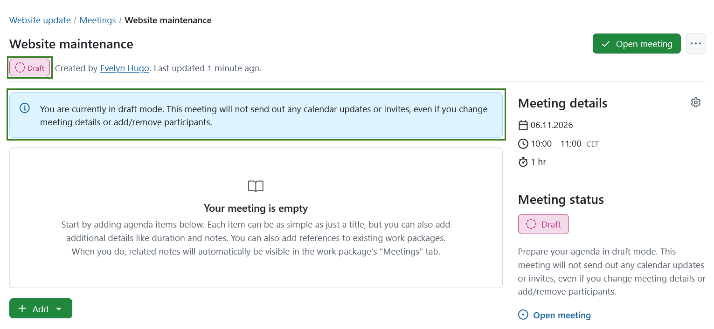

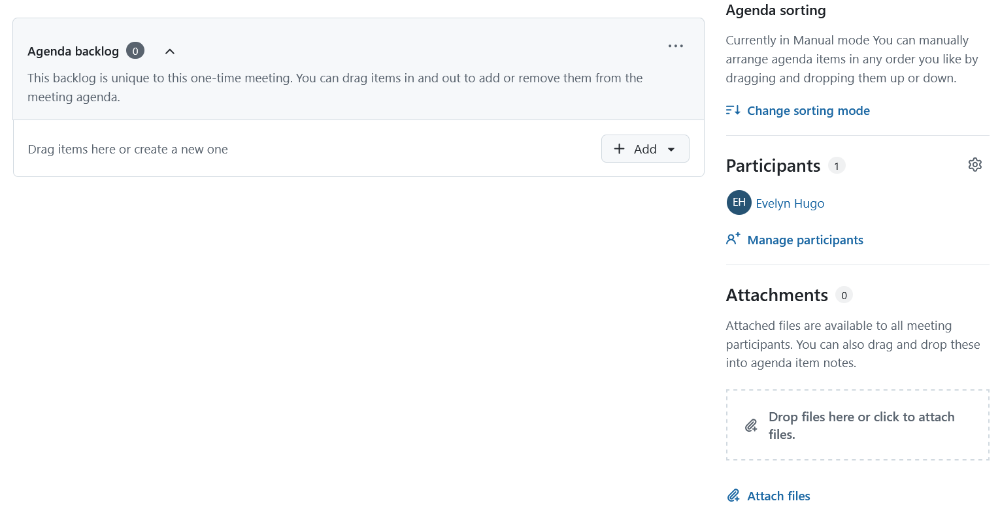

Once you are done editing the draft, click the **Open meeting** button in the top right corner. 

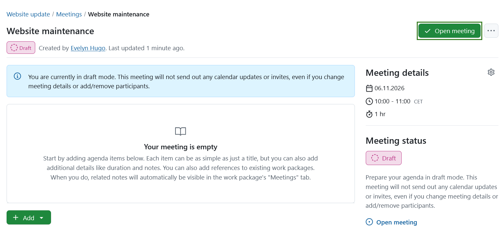

This will open a dialog, in which you can choose whether an invite and updates should be sent out to meeting participants or not. Depending on your choice, a banner will explain what action will follow. 

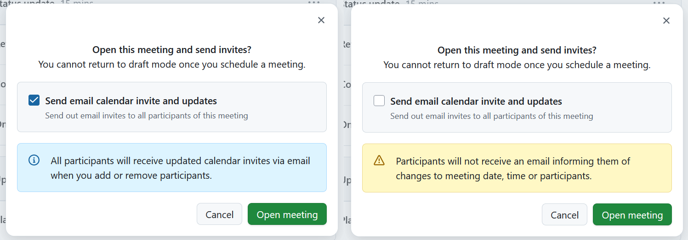

> [!IMPORTANT]
> Once you exit draft mode (by opening a meeting), you can no longer return to it.

Exiting the draft mode will change the meeting status to Open.

## Change meeting status

You can change the status of a meeting depending on whether you are preparing it, running it, or finalizing it.

[**Draft mode**](#meeting-draft-mode) is used while preparing a meeting before it is opened. In this mode you can outline the agenda, add or adjust items, work on the content, and adjust participants without running the meeting yet. Draft mode is intended for internal preparation and does not represent the start of the meeting.

Once the preparation stage is finalized, meetings in OpenProject transition to an active phase and can have three different statuses: **Open**, **In Progress**, and **Closed**. Depending on the meeting status, different options are available, such as editing the agenda, adding outcomes, or finalizing the meeting. You can transition between these statuses using the meeting status button with a drop-down menu under the meeting name or in the right-hand pane.

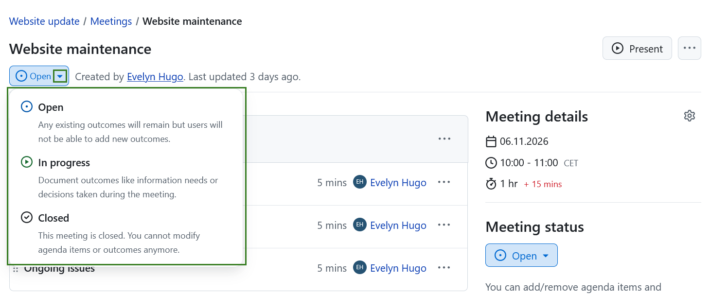

Clicking on this button will show following status options:

**Open**: reverts the meeting to an editable state, but existing outcomes remain read-only.

**In progress**: enables outcome documentation for agenda items.

**Closed**: locks the meeting and prevents further edits.

### Open meeting status

When a meeting is _Open_, you can prepare the agenda by adding or removing agenda items. Once the agenda is ready, the meeting can be started.  

> [!TIP]
>
> In an open meeting state in addition to the status menu, you will directly see the **Start meeting** link on the right.

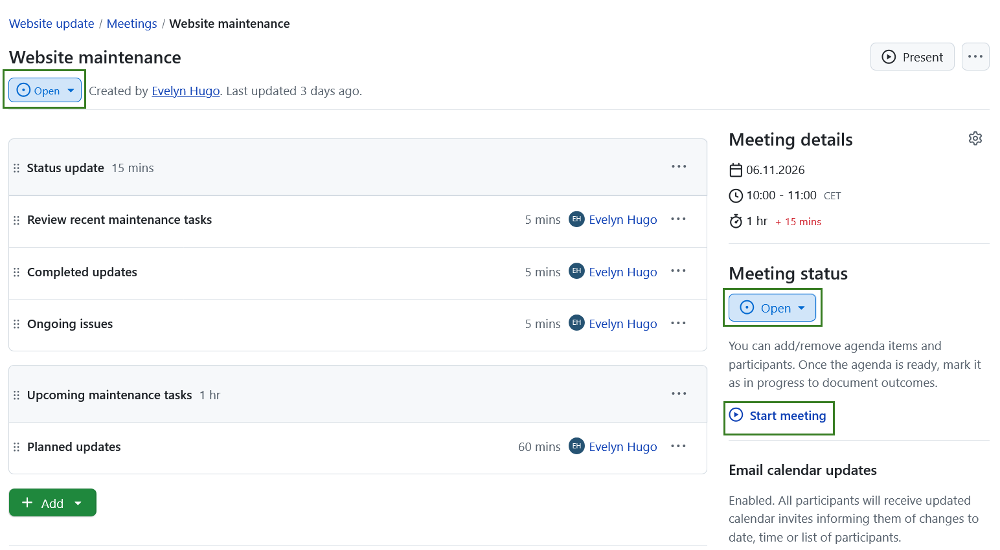

### Mark meeting in progress

Once the agenda is ready, the meeting can be started. To mark a meeting in progress you can use the dropdown status menu and select _In progress_ or click the **Start meeting** link on the right side.

Setting a meeting _In progress_ allows adding [**Agenda item outcomes**](../meeting-outcomes/#add-agenda-item-outcomes) by using the **+ Outcome** buttons.

### Close a meeting

Once all outcomes are documented, you can close the meeting. To do that use the dropdown status menu on the right side or under the meeting name. 

> [!TIP]
> In a meeting marked _in progress_ in addition to the status menu, you will directly see the **Close meeting** link on the right. 

Closing a meeting locks the current state and makes it read-only.

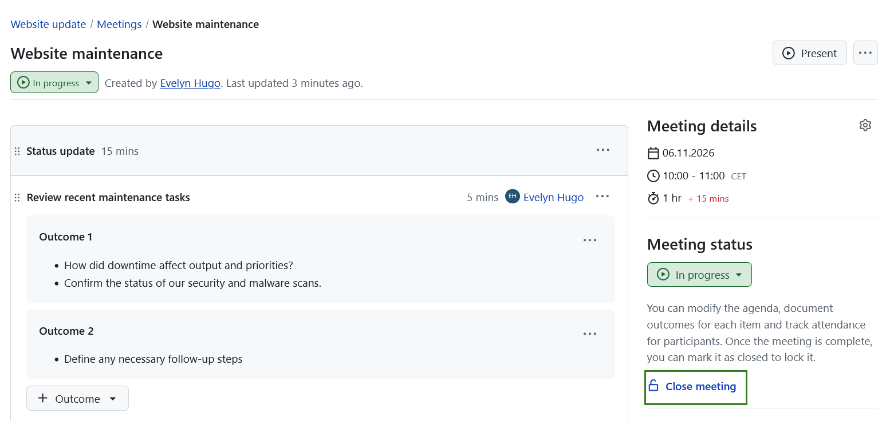

When a meeting is closed, you can still copy a link to a specific section, agenda item or outcome. Click the **More** (three dots) icon on the right and select **Copy link to clipboard**.

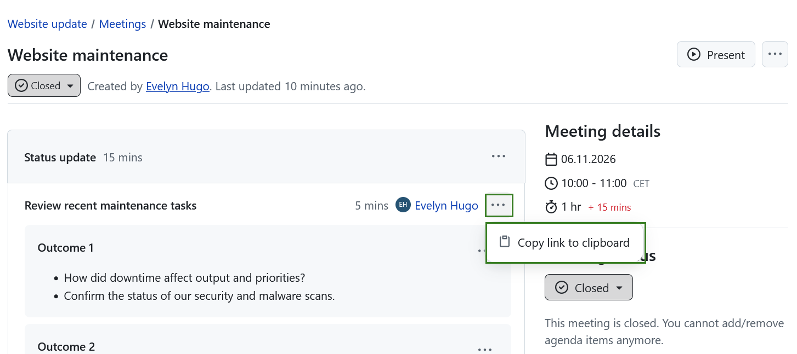

### Re-open a meeting

Once a meeting has been closed, it can no longer be edited. Project members with the permission to edit and close meetings will, however, see a **Reopen meeting** option. Clicking on this re-opens a meeting and allows further editing.

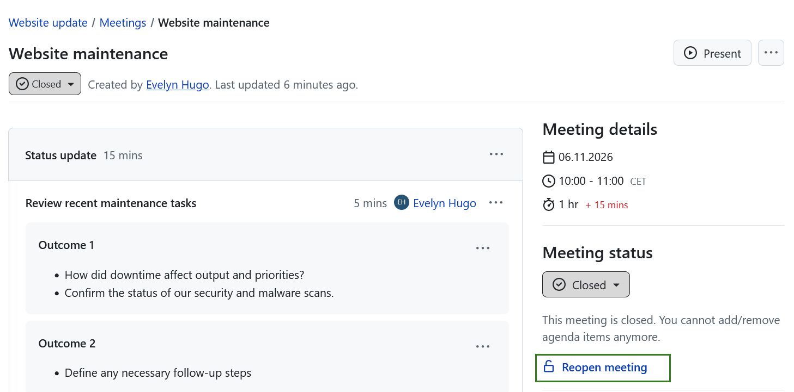

## Present a meeting

**Presentation mode** is available when you want to show the meeting content in a clean, non-editable view. This mode is intended for presenting the agenda or meeting material to participants during or before the meeting without distractions. However, agenda items can be edited in presentation mode if needed.

Presentation mode can be used regardless of the meeting status (open, in progress or closed). However, a presentation mode is not available in a draft mode or for a meeting template (recurring meetings).

> [!TIP]
> Presentation mode generally does not change the meeting status, with one exception. If a meeting has the status _Open_, clicking the _Present_ button will automatically change the meeting status to _In progress_. 

To initiate a presentation mode click the present button in the top right corner. 

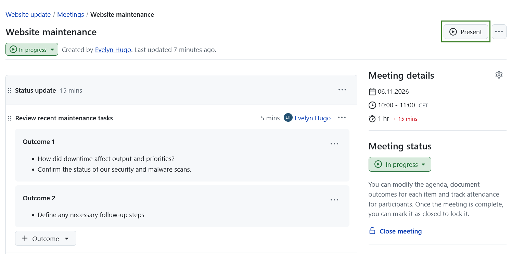

Presentation mode will be activated. It will show the following: 

1. The meeting title 
2. Exit presentation button
3. Current section (if any)
4. Current item of the selected section
5. Button to add outcomes directly during the presentation 
6. Footer with agenda progress, a running timer, and Previous / Next navigation buttons showing item titles and section titles when applicable. If the presenter changes, a small avatar of that agenda item's presenter is shown next to the previous or next item preview.

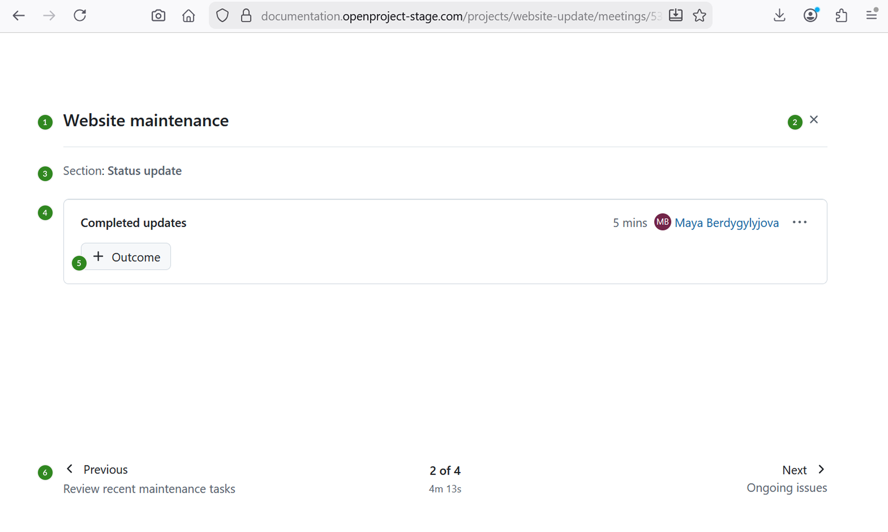

You can navigate through the meeting presentation by either clicking the _Previous/Next_ navigation buttons, or by using arrow keys of your keyboard.

Meeting changes made during the presentation are updated automatically unless an item is actively being edited.

The **More** (three dots) menu of the current agenda item allows you to move the item to the backlog. In recurring meetings, you can also move the item to the next meeting. Voting, reordering and moving items to another section are not available in presentation mode.

To exit the presentation mode click the Exit presentation button in the header. 

> [!NOTE]
> Some browsers may block automatic full-screen mode. In this case you can manually enable full-screen using the browser controls.

### Split an agenda item into multiple slides

If the notes of an agenda item are too long to fit on the screen, you can split them into multiple slides, so that you do not need to scroll during the presentation.

To do so, edit the agenda item and insert a horizontal line at every point where a new slide should begin, using the **Horizontal line** button in the toolbar of the notes editor. If you prefer Markdown, a line containing only `---` has the same effect.

In presentation mode, every part of the notes between two horizontal lines is shown as a separate slide. The title, duration, presenter and outcomes of the agenda item remain visible on every slide. The footer shows the current slide next to the agenda progress, e.g. _3 of 7 · Slide 2/4_.

The _Previous/Next_ buttons and the arrow keys first move through the slides of the current agenda item before continuing with the previous or next agenda item. When moving back to a previous agenda item, its last slide is shown.

If you edit an agenda item during the presentation, the editor shows all of its notes. After saving, the presentation returns to the slide you were on.

> [!NOTE]
> Horizontal lines only split the notes in presentation mode. On the meeting page and in exports, the notes are shown in full, with the horizontal lines as separators.
