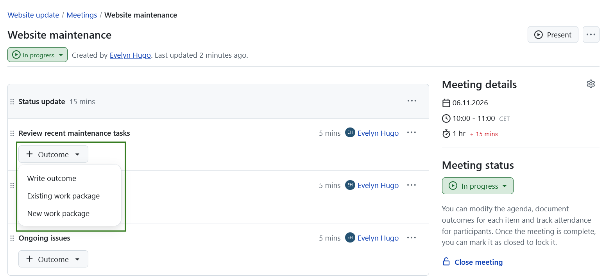
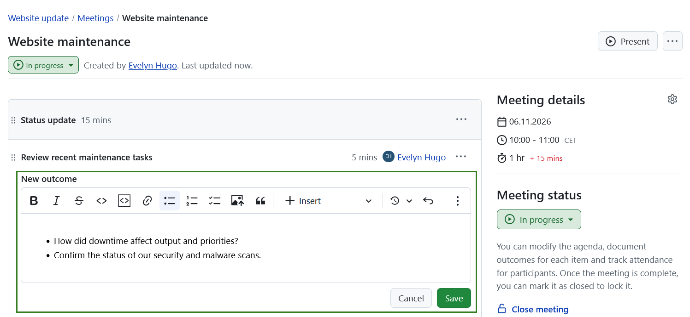
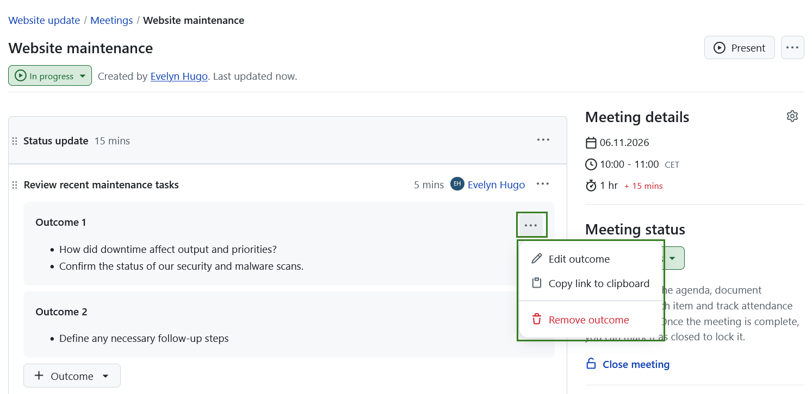
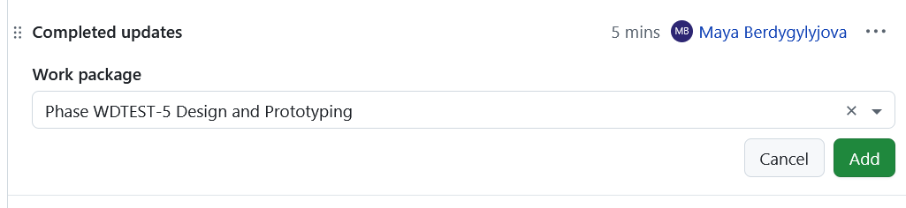
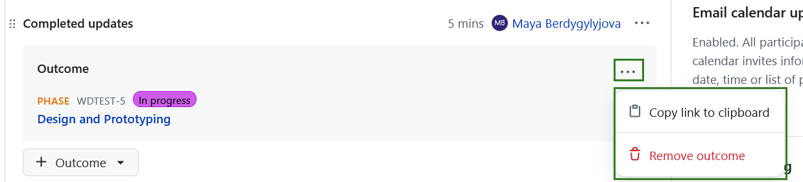
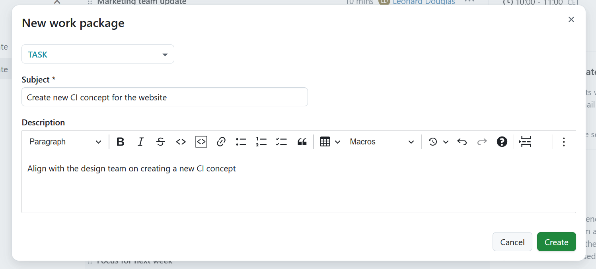
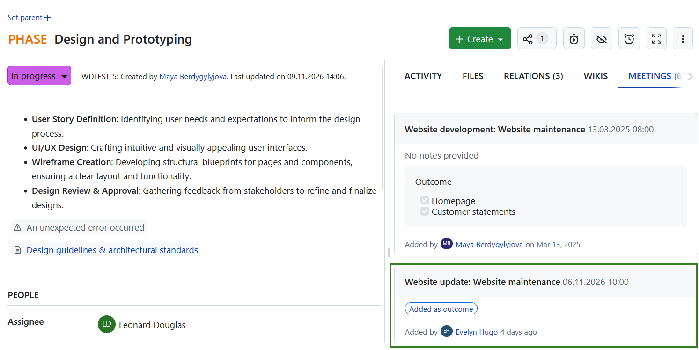

---
sidebar_navigation:
  title: Meeting outcomes
  priority: 400
description: Document decisions and follow-up tasks as meeting outcomes in OpenProject.
keywords: meetings, outcomes, minutes, decisions, work packages
---

# Meeting outcomes

The features described on this page apply to all [meeting types](../../meeting-types/), i.e. one-time meetings and individual occurrences of recurring meetings.

Meeting outcomes help you document what was discussed and decided during a meeting. You can capture outcomes as written notes (e.g. decisions or summaries) or as work packages to create follow-up tasks that stay connected to the meeting agenda.

| Topic | Content |
| --- | --- |
| [Add agenda item outcomes](#add-agenda-item-outcomes) | How to add outcomes to agenda items. |
| [Agenda outcomes in work packages](#agenda-outcomes-in-work-packages) | Where outcomes appear in work packages. |

## Add agenda item outcomes

During a meeting, stakeholders will often make relevant decisions, add useful information, or specify follow-up steps. In OpenProject, these can be added as outcomes to each agenda item. To note outcomes, the meeting status has to first be set to [in progress](../meeting-modes/#mark-meeting-in-progress). 

> [!TIP]
> To be able to add _Agenda meeting outcomes_, **Manage outcomes** permission needs to be granted under [Roles and permissions](../../../../system-admin-guide/users-permissions/roles-permissions/) in system administration.

Once a meeting is in progress, there will be a **+ Outcome** button at the end of each agenda item. Click **+ Outcome** and choose one of the following options:

- [Write outcome](#write-outcome)
- [Existing work package](#existing-work-package)
- [New work package](#new-work-package)

### Write outcome

Use this option to add a written outcome, such as a decision, a short summary, or meeting notes.

An editor will appear, allowing you to enter and format text, similar to editing an agenda item.

Click **Save** to add the agenda item outcome.

> [!TIP]
>
> You can save multiple outcomes per agenda item in OpenProject.

After saving a written outcome, you can still edit it. Click the **More** (three dots) menu on the right edge of each outcome item and select _Edit outcome_.

This menu also allows you to _Copy link to clipboard_ and to _Remove the outcome_.

### Existing work package

Use this option to add an already existing work package as a meeting outcome. This is helpful if the follow-up task already exists and you want to document that it was discussed during the meeting.

You can use the search bar to search for a work package name or ID.

Once added, the work package will appear as an outcome under the agenda item. Work package outcomes can be removed again if needed. From the **More** (three dots) menu, you can copy the work package URL or remove the outcome.

### New work package

Use this option to create a new work package directly from the meeting and add it as an outcome. This is useful for quickly creating follow-up tasks during the meeting while keeping them linked to the agenda item and meeting outcomes.

When you select **New work package**, a work package creation dialog will open. 

After creating it, the new work package will be shown as an outcome under the agenda item.

> [!TIP]
> Creating work packages as meeting outcomes requires users to have both **Manage outcomes** and **Create work packages** permissions.

## Agenda outcomes in work packages

Meeting agenda outcomes are also displayed in the **Meetings** tab of the linked work package in a read-only format. They are marked with an **Added as outcome** label so that it is clear how the work package is connected to the meeting.

