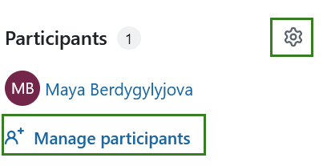
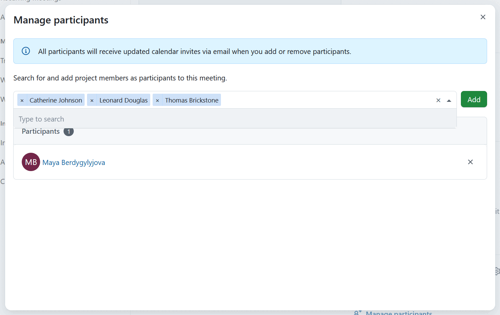
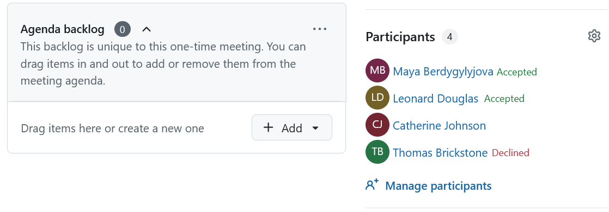
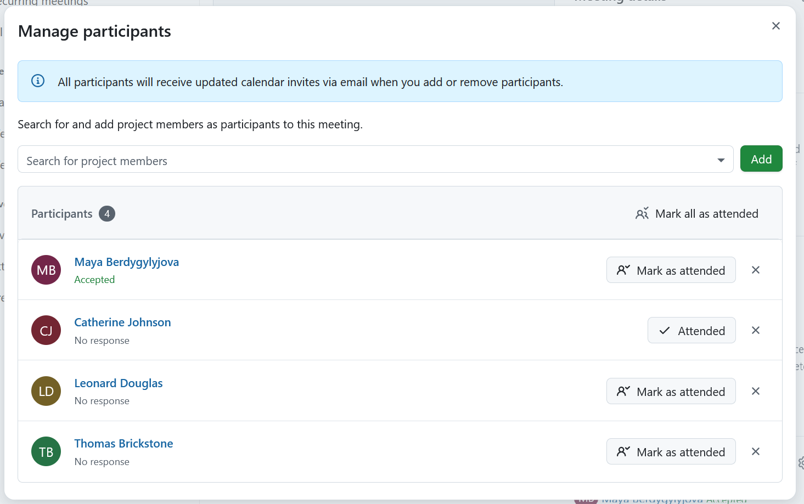
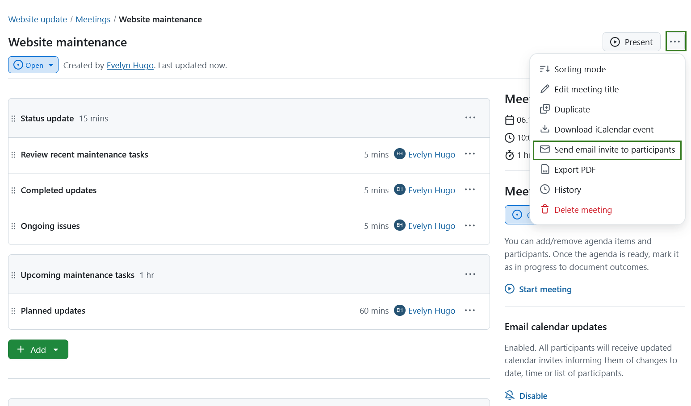
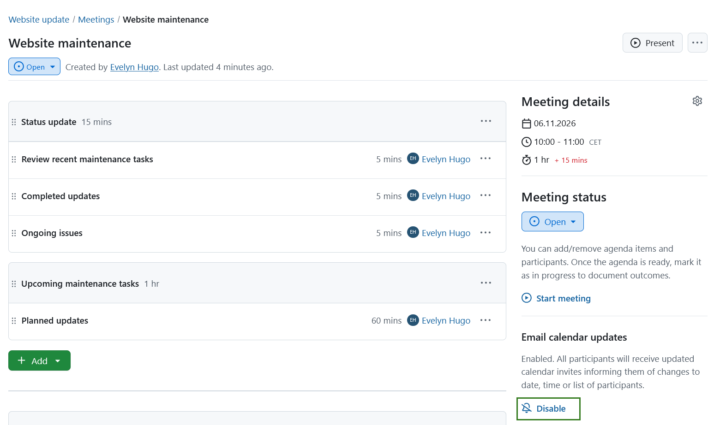
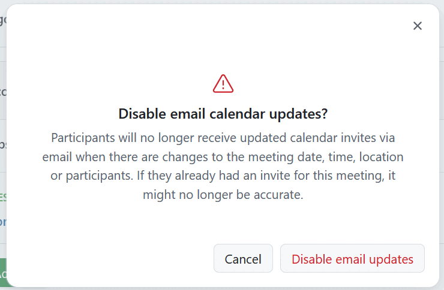
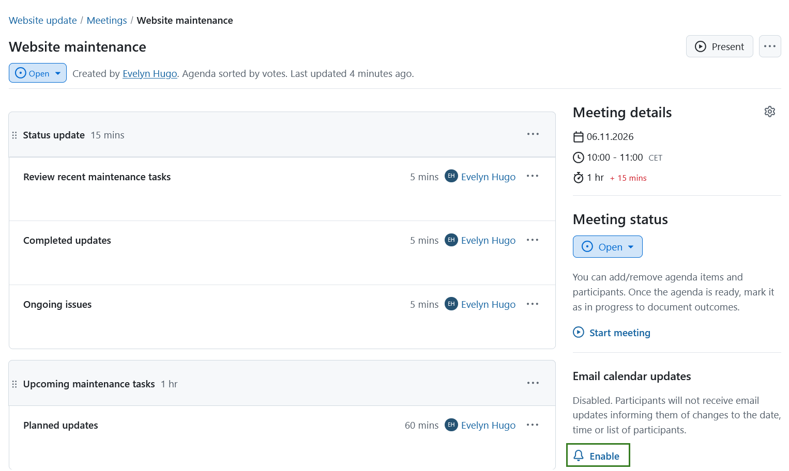
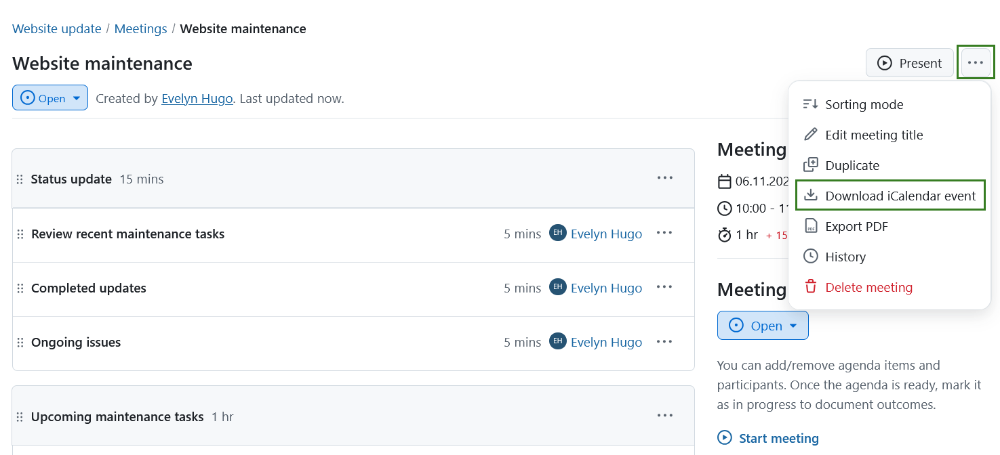

---
sidebar_navigation:
  title: Meeting participants
  priority: 700
description: Invite participants to meetings and keep them informed in OpenProject.
keywords: meetings, participants, invite, participation status, email, calendar, iCalendar
---

# Meeting participants

The features described on this page apply to all [meeting types](../../meeting-types/), i.e. one-time meetings and individual occurrences of recurring meetings.

| Topic | Content |
| --- | --- |
| [Add meeting participants](#add-meeting-participants) | How to invite people to a meeting. |
| [Send email to all participants](#send-email-to-all-participants) | How to send an email to all meeting participants. |
| [Email calendar updates](#email-calendar-updates) | How to notify participants about meeting changes. |
| [Download a meeting as an iCalendar event](#download-a-meeting-as-an-icalendar-event) | How to download a meeting as an iCalendar event. |

## Add meeting participants

You will see the list of all the invited project members under **Participants**. You can add participants (Invitees and Attendees) to a meeting in [edit mode](../meeting-setup/#edit-meeting-details). The process is the same whether you are creating a new meeting or editing an existing one. You can either click the cogwheel icon next to **Participants** section or click the **Manage participants** link under the list of existing participants.

The participants list will show everyone invited to the meeting so far. Initially, it only contains the meeting creator. To add participants, use the search bar to find one or more project members, then click **Add**. You can also add users who have been invited to the project but have not yet accepted their invitation. Depending on whether email calendar updates are enabled or disabled, a corresponding banner in the form will indicate whether an update will be sent after the changes are saved.

To remove a participant, click the _x_ icon on the far right of their name. 

Once participants are added, their **participation status** is shown in the meeting view.

Participants can respond to the meeting invitation they receive by email (**Accepted**, **Maybe** or **Declined**) directly from their email or calendar client. If [incoming emails](../../../../system-admin-guide/emails-and-notifications/#incoming-emails-settings) are enabled for your OpenProject instance, their response is synchronized back to OpenProject and visible to meeting organizers and other participants. Responses cannot be sent through a [calendar subscription](../../#subscribe-to-meetings), as subscriptions are read-only.

Once the meeting has started (status set to _In progress_), you can record attendance by selecting the **Mark as attended** button.

## Send email to all participants

You can send an email reminder to all the meeting participants. Select the dropdown by clicking on the **More** (three dots) icon in the top right corner and select **Send email invite to participants**. An email reminder with the meeting details (including a link to the meeting) is immediately sent to all invitees and attendees.

## Email calendar updates

**Email calendar updates** section on the right side shows whether the setting to notify participants of any meeting changes via email is activated. To enable it click the **Enable** button, to disable it click the **Disable** icon. Here is an example of disabling the calendar updates. 

You will then see a warning message informing you of the consequences. You can either cancel or confirm disabling the email updates at this point. 

You can always re-activate it by clicking the **Enable** icon. 

> [!NOTE]
> Enabling or disabling email calendar updates does not affect calendar subscriptions. 
> If you are unsure whether a meeting change will trigger an email or update your calendar subscription, see the [Meetings FAQ](../../meetings-faq/#what-is-the-difference-between-calendar-subscriptions-and-email-calendar-updates).

## Download a meeting as an iCalendar event

You can download a meeting as an iCalendar event. Select the dropdown by clicking on the **More** (three dots) menu in the top right corner and select the **Download iCalendar event**. 

Read more about [subscribing to a calendar](../../../calendar/#subscribe-to-a-calendar).

Please keep in mind that downloading a meeting as an iCalendar event adds it to your calendar, but it does not keep the meeting synchronized automatically.

> [!TIP]
> If you want your calendar to stay up to date with all your meetings, you can [subscribe to meetings](../../#subscribe-to-meetings) instead of downloading individual iCal events. To respond to a meeting invitation, use the invitation you receive by email (see [Add meeting participants](#add-meeting-participants)).
