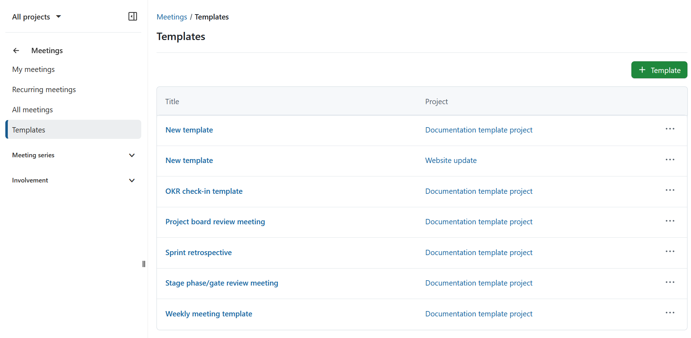
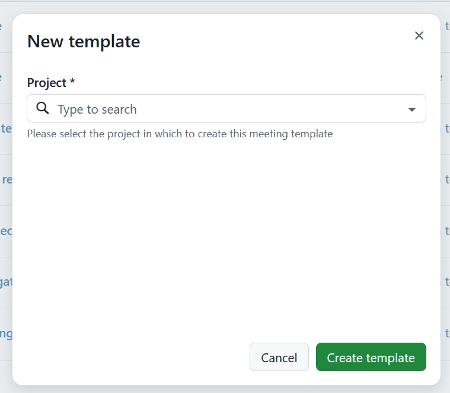
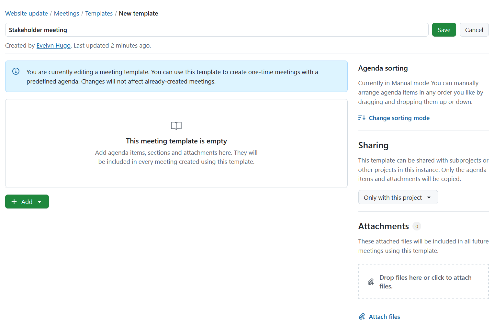
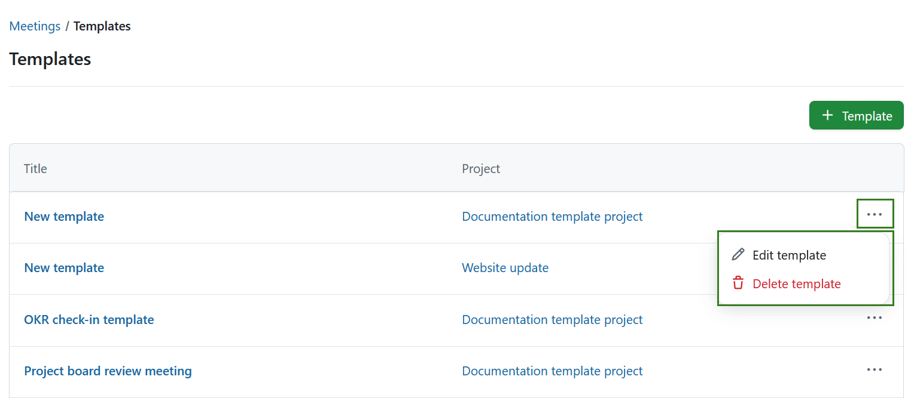
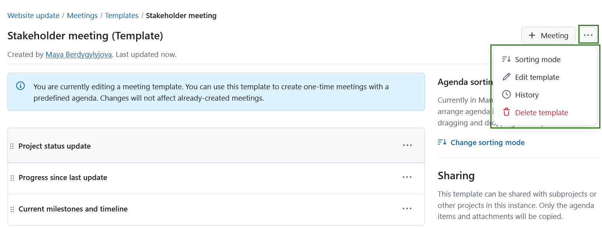
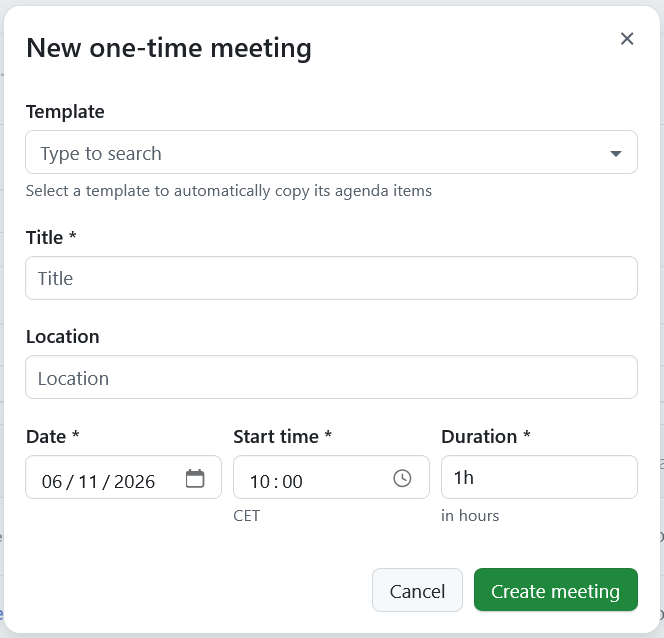
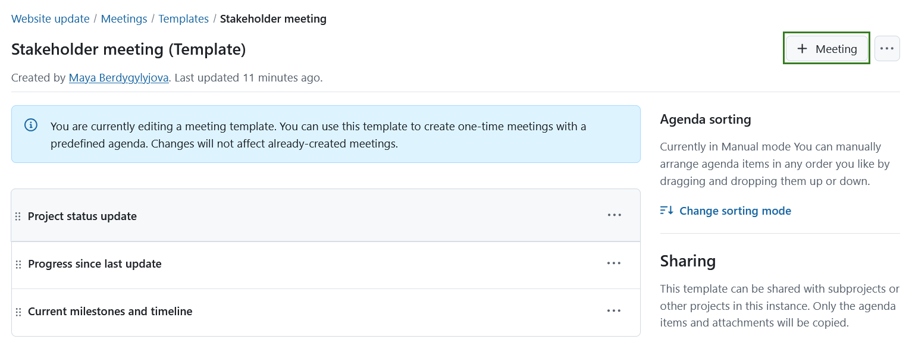

---
sidebar_navigation:
  title: Meeting templates
  priority: 800
description: Use reusable templates for one-time meetings in OpenProject (Enterprise add-on).
keywords: meetings, meeting templates, one-time meeting, enterprise add-on
---

# Meeting templates (Enterprise add-on)

[feature: meeting_templates ]

Meeting templates allow you to reuse a predefined meeting structure when creating one-time meetings. They make it easy to start meetings with a proven structure instead of creating the agenda from scratch each time. 

Meeting templates are always associated with a specific project, but they can be created either from within a project or from the global **Meetings** page. To access them, open the **Meetings** module and select **Templates** from the left-hand menu. In the **Templates** view you can see all templates you have access to. When viewing templates globally, an additional **Project** column indicates which project each template belongs to. 

> [!NOTE]
> The **Templates** menu item is only shown to users who have the permission to create meetings.

> [!TIP]
> Recurring meetings use their own template, which is the basis for all occurrences of a series. See [Edit recurring meetings template](../../meeting-types/recurring-meetings/#edit-recurring-meetings-template).

| Topic | Content |
| --- | --- |
| [Create a template](#create-a-template) | How to create a new meeting template. |
| [Edit or delete a template](#edit-or-delete-a-template) | How to change, delete or view the history of a template. |
| [Create a meeting from a template](#create-a-meeting-from-a-template) | How to use a template for a new meeting. |

## Create a template

Click the green **+ Template** button to create a new template. When creating a template from the global view, you first need to select the project the template should belong to. Click the **Create template** button to proceed.

In the template that opens, enter and save a title. Define the agenda structure and add attachments to the template the same way as you would when creating a one-time meeting. You can also define whether this template should be kept within the project, shared with subprojects, or all other projects in this instance. If the template is to be shared, the agenda items and attachments will be copied to sub- or other projects when the template is used.

## Edit or delete a template

Use the **More** menu (⋯) next to a template to edit or delete the template. 

You can change the sorting mode, edit, delete, or view the history through the **More (three dots)** menu in the top right corner and selecting the respective option.

## Create a meeting from a template

When creating a new **one-time meeting**, you can optionally select a **Meeting template**. The template field is empty by default. After selecting a template, the agenda and attachments are copied to the new meeting.

> [!NOTE]
> Changes made to the template later will not affect meetings that were already created from it.

You can also open a template and click the **+ Meeting** button to create a new meeting in the same project.

