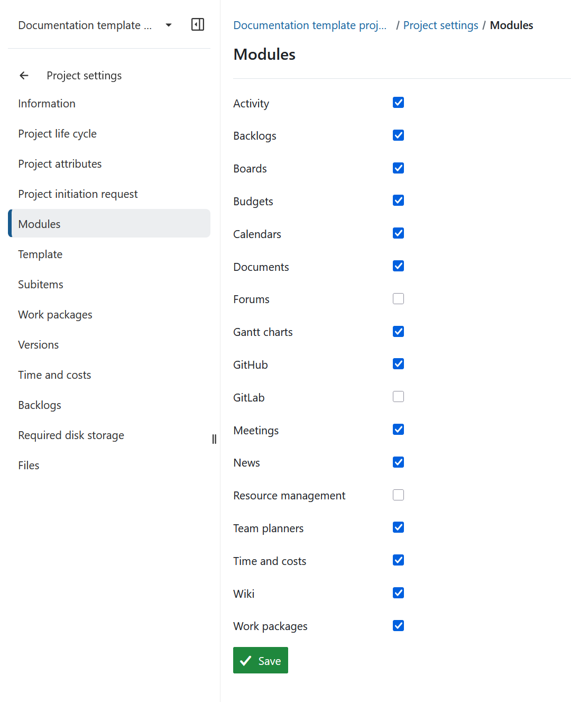

---
sidebar_navigation:
  title: Modules
  priority: 700
description: Enable modules in a project.
keywords: modules, select module in project, add
---

# Enable modules in a project

To **activate or deactivate modules** in a project, navigate to **Project settings → Modules**.

Setting a checkmark next to a module will activate it for the project, and a new menu item will appear in the project menu on the left.

## Module dependencies

Activating the [Backlogs module](../../../backlogs-scrum/) automatically activates the [Boards module](../../../agile-boards/), as Boards is required for working with sprint boards.
