---
sidebar_navigation:
  title: Resource management
  priority: 869
description: Manage project resources and plan team capacity with Resource management in OpenProject.
keywords: resource management, capacity planning, resource planner, staffing, allocations
---

# Resource management

[feature: resource_management]

The **Resource management** module in OpenProject enables project managers to plan work based on people's availability, skills and capacity. Instead of only planning *what* needs to be done, you can also plan *who* should do the work and *when*.

Within a project, you can create one or more **resource planners** to organize work packages, allocate work to users and monitor team capacity using different planner views.

## Resource management module

### Prerequisites

Before starting with Resource management:

- Activate the **Resource management** module under [**Project settings → Modules**](../projects/project-settings/modules).
- Ensure users have configured working schedules for realistic capacity planning. For more information, see the [**Schedule and availability** guide](../account-settings/schedule-and-availability).

To open the Resource management module, select a project and then select **Resource management** from the project menu.

The Resource management overview consists of a navigation sidebar and a list of existing resource planners.

The navigation sidebar contains:

- a search bar for easier navigation
- the **Staffing** view
- all public resource planners
- your private resource planners

Favorite resource planners are marked with a star icon.

The main content area lists all existing resource planners in the project, including their names, number of work packages and members, and start and finish dates. Select a planner name to open it.

Select the **More** menu (...) at the end of a planner row to:

- edit the planner
- add or remove it from your favorites
- make it public or private
- delete it

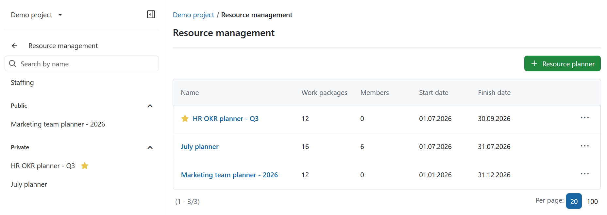

## Resource planners

A **resource planner** defines how resources are displayed within a project. Each planner can contain one or more **planner views**, allowing you to analyze the same project data from different perspectives.

You can create multiple resource planners for different teams, departments, planning periods or scenarios.

### Create a resource planner

To create a new resource planner, select the **+ Resource management** button.

In the form that opens, specify the following details:

- **Name** of the resource planner
- **Date range**
- **Default view** type. Available options are:
  - Work packages timeline
  - Users timeline
  - Work packages list
  - Users card list

  Depending on the selected [planner view](#planner-views), you will specify additional settings in the next step.
- **Public** checkbox
- **Favorite** checkbox

Select **Next**.

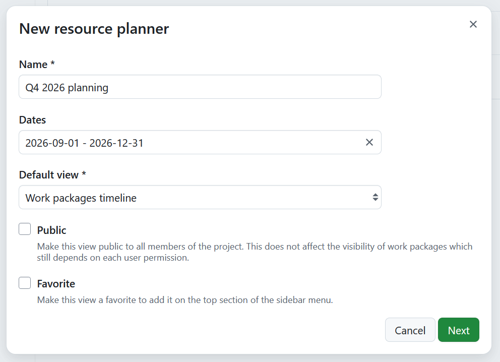

Next, configure the first planner view. This can be changed later.

Specify:

- **Name** of the planner view
- How the view should be populated:
  - **Automatically filtered** – displays all work packages matching the selected filters.
  - **Manually hand-picked** – allows you to add and remove work packages individually.

If you choose **Automatically filtered** for one of the two work package views, define which work packages should be included by specifying:

- status
- additional work package filters, including work package attributes and custom fields

Select **Create**.

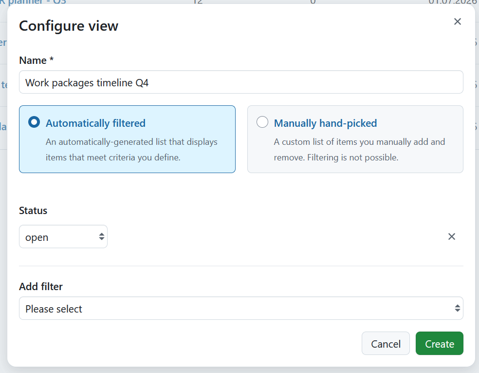

The new resource planner opens with its first planner view.

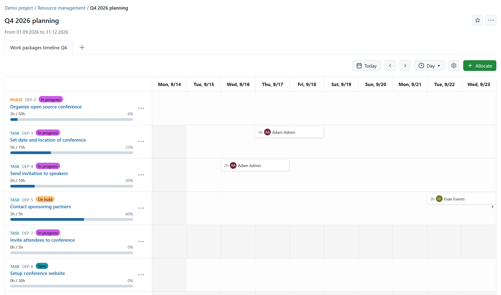

### Edit a resource planner

You can edit a resource planner either from the Resource management overview or from within an open resource planner.

To edit a planner:

1. Select the **More** menu (...).
2. Select **Edit**.

You can update:

- planner name
- date range
- default view
- public visibility
- favorite status

You can also:

- add planner views
- rename planner views
- edit planner view filters
- delete planner views

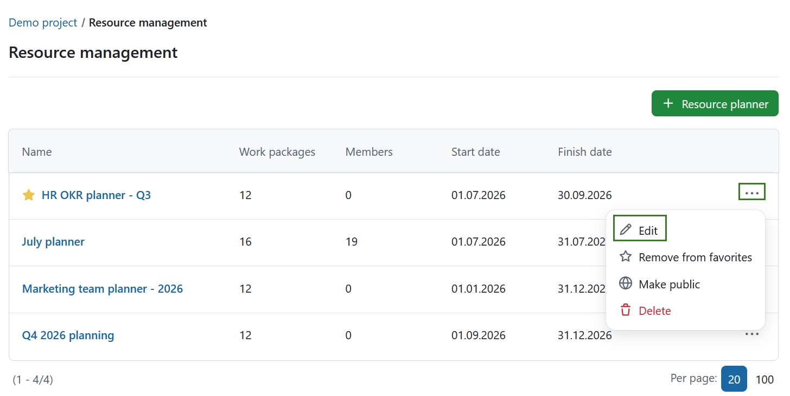

### Delete a resource planner

You can delete a resource planner either from the Resource management overview or from within an open resource planner.

To delete a resource planner:

1. Select the **More** menu (...).
2. Select **Delete**.
3. Confirm the deletion.

> [!NOTE]
> Deleting a resource planner removes the planner and all of its planner views. It does not delete any work packages, allocated times or project data.

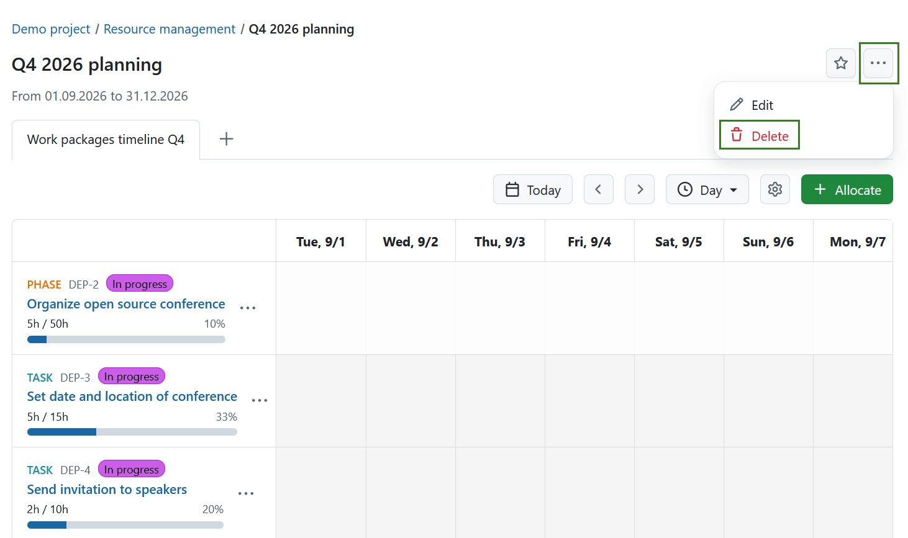

## Planner views

Each resource planner can contain multiple planner views. Planner views display the same planning data in different ways, allowing you to focus on work packages, users or staffing activities.

You can add additional planner views at any time. To do so, select the **+** icon next to the existing planner view tabs and choose the desired planner view type.

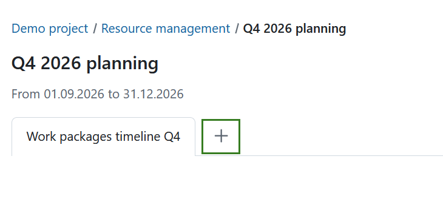

Timeline views share the same toolbar, which lets you:

- select **Today** to return to the current date
- navigate forwards or backwards using the arrow buttons
- change the zoom level (**Day**, **Calendar week** or **Month**)
- configure the current view
- create a new allocation

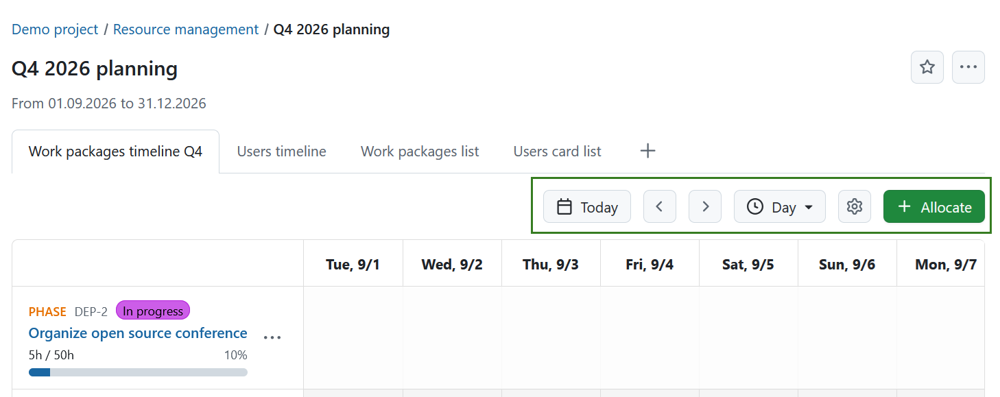

### Work packages timeline

The **Work packages timeline** displays work packages together with their planned allocations over time.

The left side lists all work packages included in the planner.

Each work package displays:

- work package type
- ID
- status
- subject
- allocated hours
- completion progress

Select the **More** menu (...) for additional actions, including:

- **See allocation**
- **Edit total work**

The timeline displays allocations across the selected time scale.

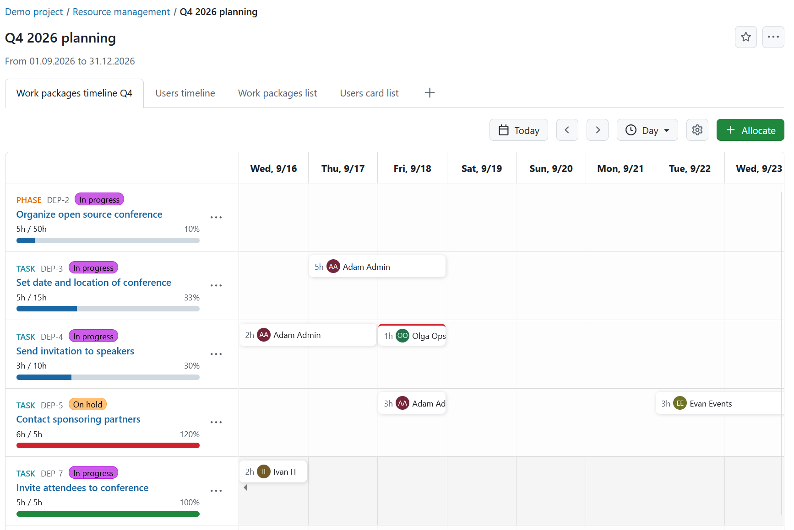

### Users timeline

The **Users timeline** groups planned work by user instead of by work package.

> [!TIP]
>
> Resource planners do not include placeholder users.

This view helps identify:

- available capacity
- overallocated users
- users without configured working schedules

Warning icons indicate users who:

- have no configured working schedule
- are allocated beyond their available capacity

The timeline displays each user's planned allocations across the selected period.

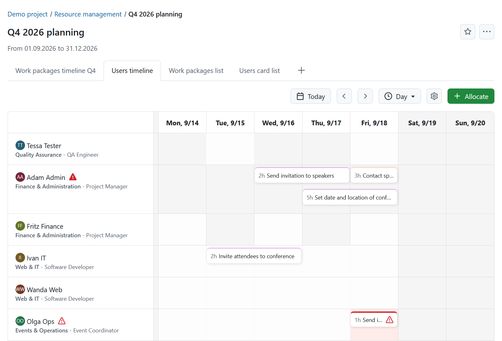

### Work packages list

The **Work packages list** displays planning information in a table.

Use this view when you prefer working with planning data in a table instead of a timeline.

Besides the standard work package information, it includes planning-specific columns such as:

- Allocation
- Allocated members

Each row provides work package-specific actions in the **More** menu (...), including:

- **See allocation**
- **Edit total work**
- **Add user group**
- **Add filter criteria**

Use the **Configure view** icon to customize the displayed columns.

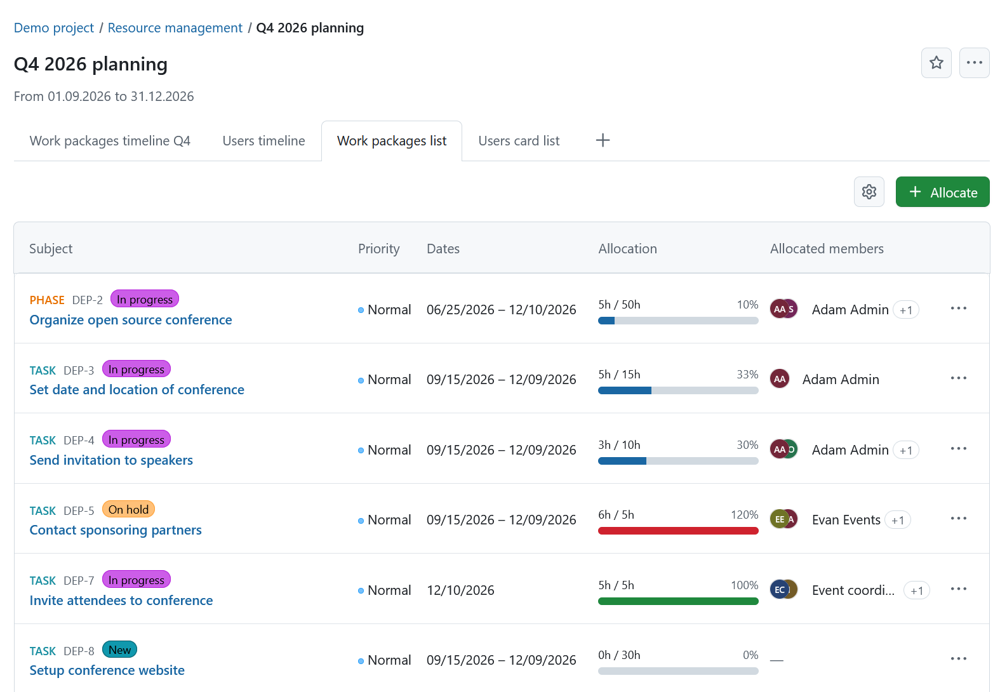

### Users card list

The **Users card list** provides an overview of available project members.

Each card displays information that helps with staffing decisions, including:

- user name
- department (if configured)
- status
- configured working hours
- user attributes, such as spoken languages or key skills, as configured for the view
- current utilization
> [!TIP]
> The utilization bar is relative to the date range of the resource planner. It will show the user's utilization within that given range. If no range is set up, no utilization is displayed.

Use the **Configure view** icon to choose which user attributes are displayed on the cards.

Use this view to quickly identify users with the required skills and available capacity.

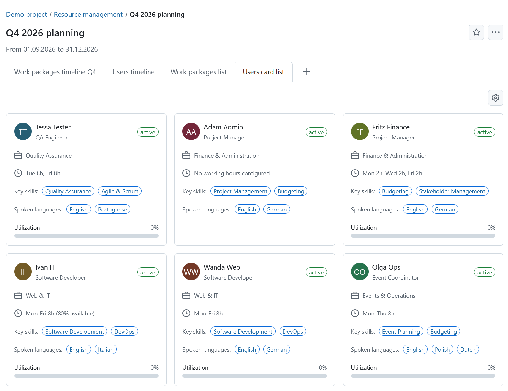

## Allocate work

You can create allocations from all planner views.

Depending on the current planner view, you can:

- select the **+ Allocate** button above the planner
- select **See allocation** from the **More** menu (...) of a work package
- select a user card
- select a work package directly in the timeline

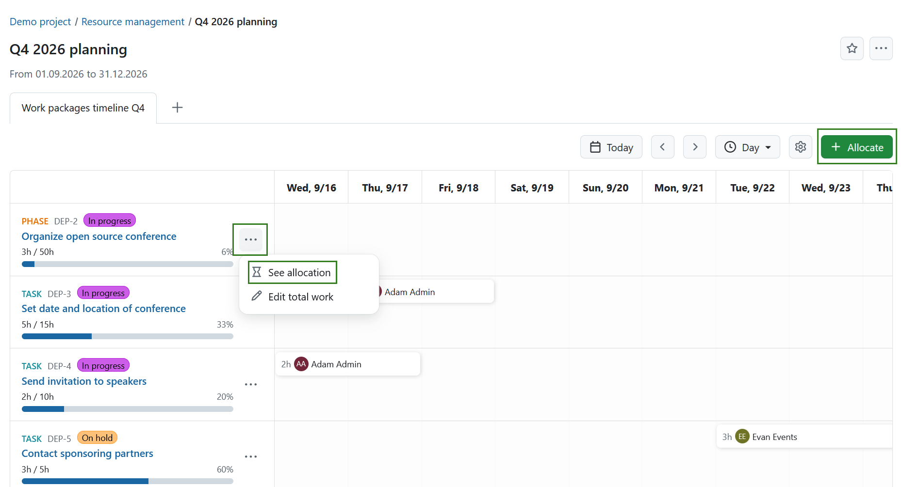

The **Allocation** dialog displays all existing allocations for the selected work package.

Select **Allocate resource** to create a new allocation.

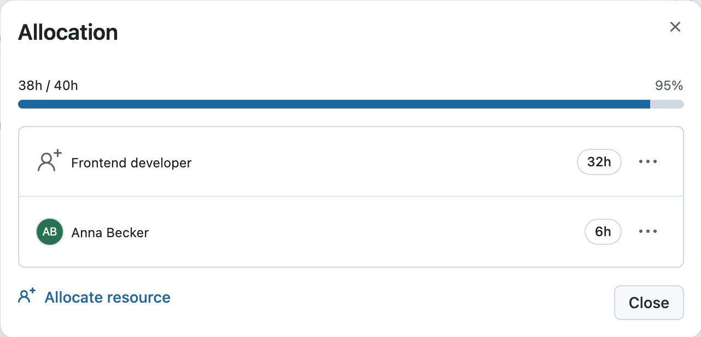

In the **Allocate resource** dialog, specify:

- **Assignee** – select a project member or a [placeholder user](#allocate-to-a-placeholder-user).
- **Work package** – this field is pre-filled when creating an allocation from a work package.
- **Dates** – if the selected dates fall outside the planned start and due dates on the work package, OpenProject displays a warning.
- **Hours** – enter the planned number of hours.

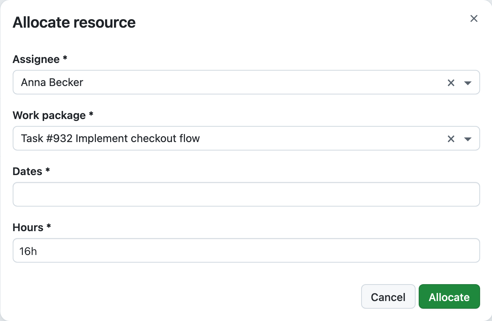

Select **Allocate**.

The new allocation is immediately displayed in the planner. Allocated hours and utilization are updated automatically.

The allocated user also sees the allocation on their [My work](../time-and-costs/my-work/#resource-allocations-in-my-work) page. OpenProject distributes the allocated hours over the user's working days within the allocation dates, so they can see how many hours per day they are expected to work on which work package. Time they log on the work package reduces the remaining hours.

> [!TIP]
> If the selected user would be allocated beyond their working hours, OpenProject asks you to confirm. Select **Allocate overtime** to save the allocation anyway and schedule overtime on the user or **Back** to change it.

### Allocate to a placeholder user

If you know which skills you need, but have not yet decided who will do the work, allocate the work to a [placeholder user](../../system-admin-guide/users-permissions/placeholder-users/). Placeholder users describe the kind of person you need with [criteria](../../system-admin-guide/users-permissions/placeholder-users/#placeholder-user-criteria), for example a job title or spoken languages.

Select the placeholder user in the **Assignee** field. Its criteria are displayed below the field.

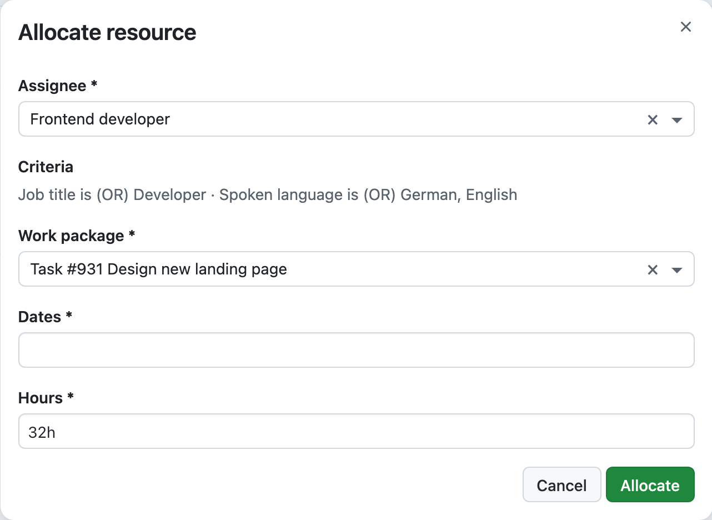

Only placeholder users with criteria can be selected. The allocation is listed in the [Staffing](#staffing) view until a user is assigned to it.

If no suitable placeholder user exists yet, type its name in the **Assignee** field and select **Create placeholder user with filter criteria**. This option is available if you are allowed to create placeholder users.

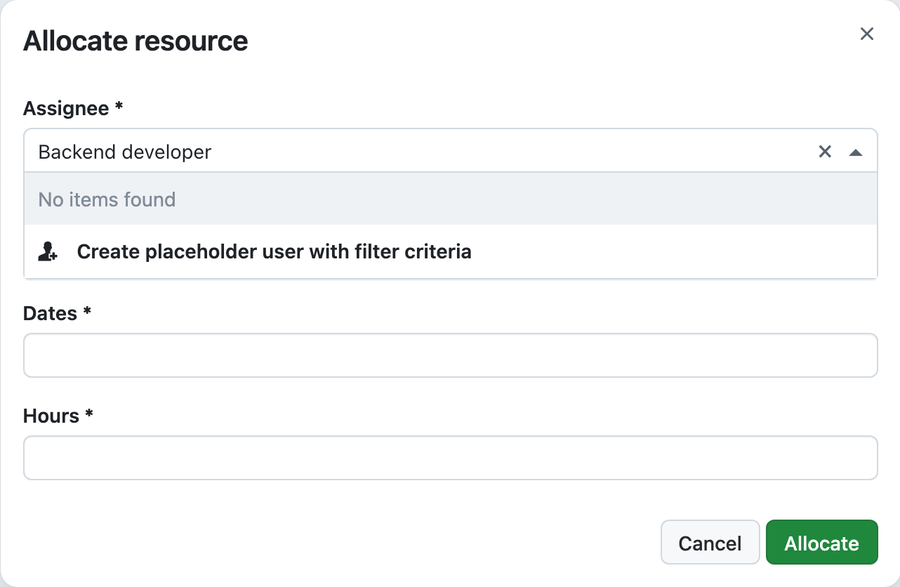

In the **Create placeholder user** dialog, enter a **Name**, optionally a **Description**, and add at least one filter. Select **Create**. The new placeholder user is selected as the assignee of the allocation.

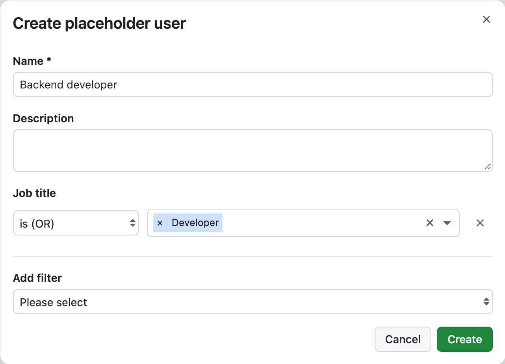

### Edit or delete an allocation

To edit an allocation, open the **Allocation** dialog of the work package and select **Edit** from the **More** menu (...) next to the allocation. You can change the assignee, dates and hours. Select **Save**.

If a user was assigned to the allocation in the [Staffing](#staffing) view, the dialog shows the placeholder user the allocation was staffed from. You can then only select users that match the criteria of this placeholder user.

To delete an allocation, select **Delete** from the **More** menu (...) or in the edit dialog and confirm the deletion.

## Allocations in work packages

If the Resource management module is activated in a project, work packages show two additional attributes in the **Estimates and progress** section:

- **Allocated** – the allocated hours compared to the work of the work package. The bar turns green when exactly the work is allocated and red when more is allocated.
- **Allocated resources** – the users and placeholder users that work is allocated to.

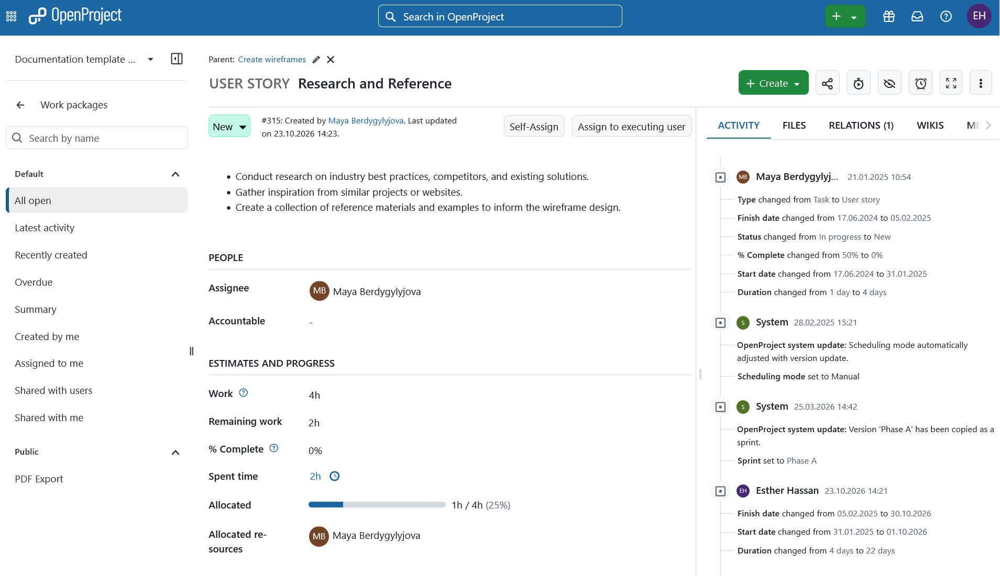

Select one of these attributes to open the **Allocation** dialog. It lists all allocations of the work package with their hours. A red warning icon is displayed next to users who are allocated beyond their working hours. If no work is set for the work package, the dialog shows *No work planned on this work package*.

From the **Allocation** dialog you can [create](#allocate-work), [edit or delete](#edit-or-delete-an-allocation) allocations.

You can also create an allocation by selecting **Allocate resource** from the **More** menu of a work package or from the context menu in a work package table.

> [!NOTE]
> To see allocations you need the **View resource planners** permission. To create, edit or delete them you need the **Allocate user resources** permission.

## Staffing

The **Staffing** view helps you assign users to work that was [allocated to placeholder users](#allocate-to-a-placeholder-user).

To open it, select **Staffing** in the Resource management menu. You need the **Assign users to placeholder user allocations** permission.

The Staffing view lists all allocations in the project that are allocated to a placeholder user and do not have a user assigned yet. It displays:

- resource (the placeholder user)
- work package
- dates
- requested time

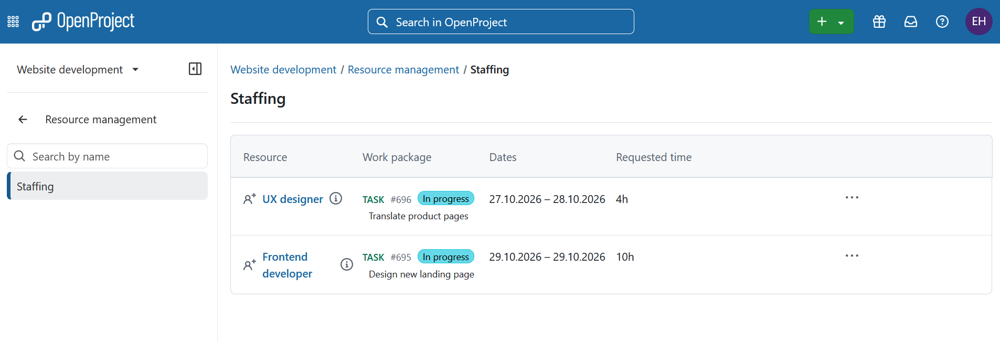

Select the **More** menu (...) and then **Assign user** to open the **Assign** dialog.

The **Assign** dialog shows the work package, the requested dates and time, and the criteria of the placeholder user. Below, it lists all project members that match the criteria together with their available hours in this period.

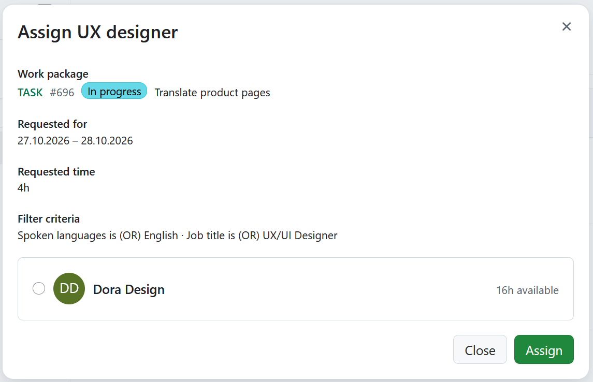

Select a user and then select **Assign**. If the user would be allocated beyond their working hours, OpenProject asks you to confirm with **Assign anyway**.

The allocation is now assigned to the user and removed from the Staffing view. The placeholder user stays recorded on the allocation, so you can see what was originally requested.

## Global resource planners

Besides resource planners within a project, you can create **global resource planners**. They let you plan resources and allocations across several projects.

To open them, select **Resource management** from the [global modules](../home/global-modules/) menu.

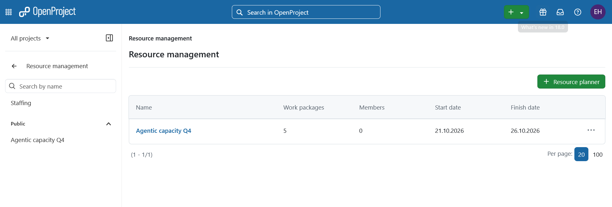

To create a global resource planner, select **+ Resource planner**. The form is the same as for [project resource planners](#create-a-resource-planner).

Global resource planners differ from project resource planners in the following ways:

- Work package views can be filtered by **Project** to choose which projects to plan across. Manually hand-picked views let you add work packages from all projects with the Resource management module activated.
- The work package views show an additional **Project** column.
- User views let you add any user you are allowed to see, not only members of one project.
- When you allocate work, the allocation belongs to the project of the selected work package. Only members of that project can be selected as assignee.

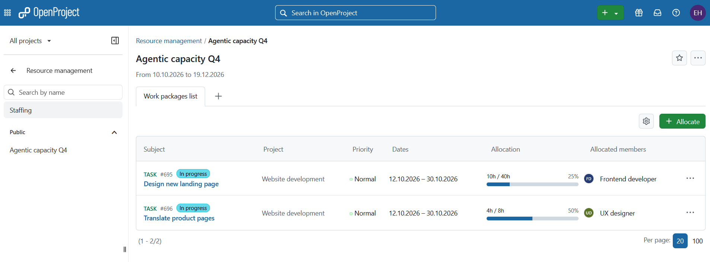

You only see the projects, users and allocations you are allowed to see.

### Global staffing

The global Resource management menu also contains a **Staffing** view. It lists the open placeholder user allocations of all projects in which you can assign users, grouped by project.

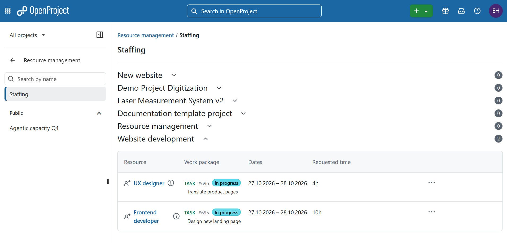

Assigning a user works the same way as in the [project Staffing](#staffing) view. Only members of the allocation's project can be assigned.

### Permissions for global resource planners

Global resource planners use two global permissions:

- **View global resource planners** – allows users to open the global Resource management section, create their own global resource planners and view public ones.
- **Manage public global resource planners** – allows users to make their global resource planners public and to manage public global resource planners of other users.

For more information, see [Roles and permissions](../../system-admin-guide/users-permissions/roles-permissions/).
