---
sidebar_navigation:
  title: My work
  priority: 950
description: Get an overview of time logs and resource allocations in a calendar, list or stack view. Easily log time directly from My work page.
keywords: my work, time tracking, log time, time spent, calendar, time spent calendar, time logs, stack, resource allocations
---

# My work

## Overview

The _My work_ module offers a clear overview of your personal time entries and the work that is [allocated to you](#resource-allocations-in-my-work). You can quickly log time directly from this page. To access it, select **My work** from the left-hand menu.

Alternatively, click the grid icon in the top left corner and select _My work_ from the overlay menu that will open.

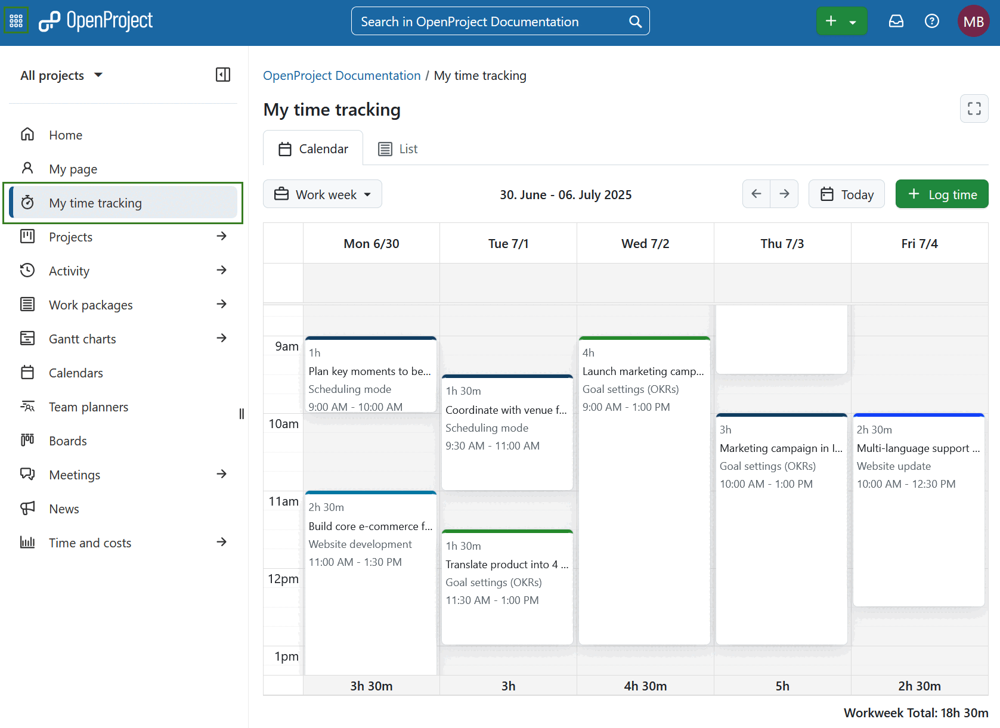

### My work page filters

1. On the _My work_ page, you’ll find the following interface elements:
   1. **Zen mode** button — toggles a distraction-free view.
   2. **Tab selector** — switch between [_Calendar_](#calendar-view), [_List_](#list-view) and [_Stack_](#stack-view) views.
   3. **Zoom level dropdown menu** — choose the time scale for the view. Following options are available:
      - Day
      - Work week
      - Week
      - Month
   4. **Displayed date range** — shows the currently visible timeframe.
   5. **Navigation arrows** — move to the previous or next time period.
   6. **Today** button — jump directly to the current day.
   7. **+ Log time** button — add a new time entry.

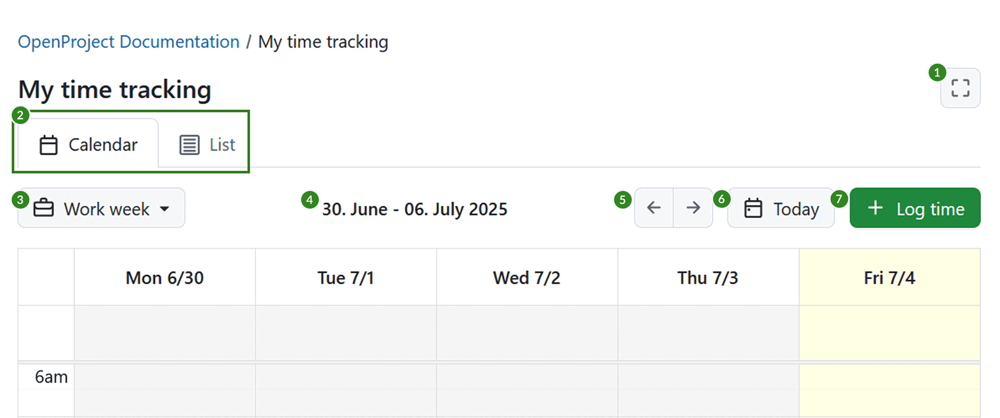

If [Resource management](../../resource-management/) is available, an additional dropdown menu next to the zoom level lets you choose which entries are displayed:

- **All entries**
- **Logged time only**
- **Allocations only**

OpenProject remembers the view and zoom level you used last and it will be used when coming back to the **My Work** section.

### Calendar view

The _Calendar_ view opens by default if start and finish times for time entries have been enabled in [System Administration](../../../system-admin-guide/time-and-costs). You can adjust the zoom level using the dropdown menu, with options for **Day**, **Work week**, **Week**, or **Month**. The current day is highlighted.

Existing time entries appear on the corresponding days they were logged. Entry colors reflect the type of work package associated with the logged time.

At the top section of each day in the calendar, there is a dedicated area that allows you to log time without specifying a start or finish time. This is useful for quick entries or for logging effort that isn't tied to a specific time range.

You can log time by selecting a time range anywhere on the calendar or by using the **+ Log time** button.

You can drag and drop time entries to reposition them within the same day or move them to a different day. To adjust the duration of an entry, drag the top or bottom edge of the time entry up or down.

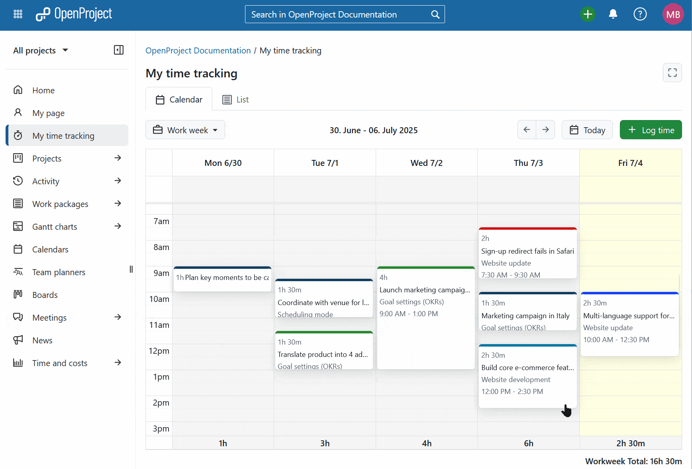

To edit a time entry, click it in the calendar, make your changes, and save. You can also delete it from the same menu.

If work is allocated to you in [Resource management](../../resource-management/), your [resource allocations](#resource-allocations-in-my-work) are displayed in the area at the top of each day, next to time entries without start and finish time. Allocations have a dashed border and show the hours you are expected on that work package on that day. They cannot be moved or resized. Click an allocation to open the work package or to log time from it.

At the bottom of each day a sum of hours per day is displayed. If work is allocated to you, it also shows the allocated hours and compares the sum of logged and allocated hours with your working hours of that day, for example *9h/8h*. This value is shown in red if you are planned for more than your working hours. If week or month is selected, a total of the logged hours is also shown in the bottom right corner.

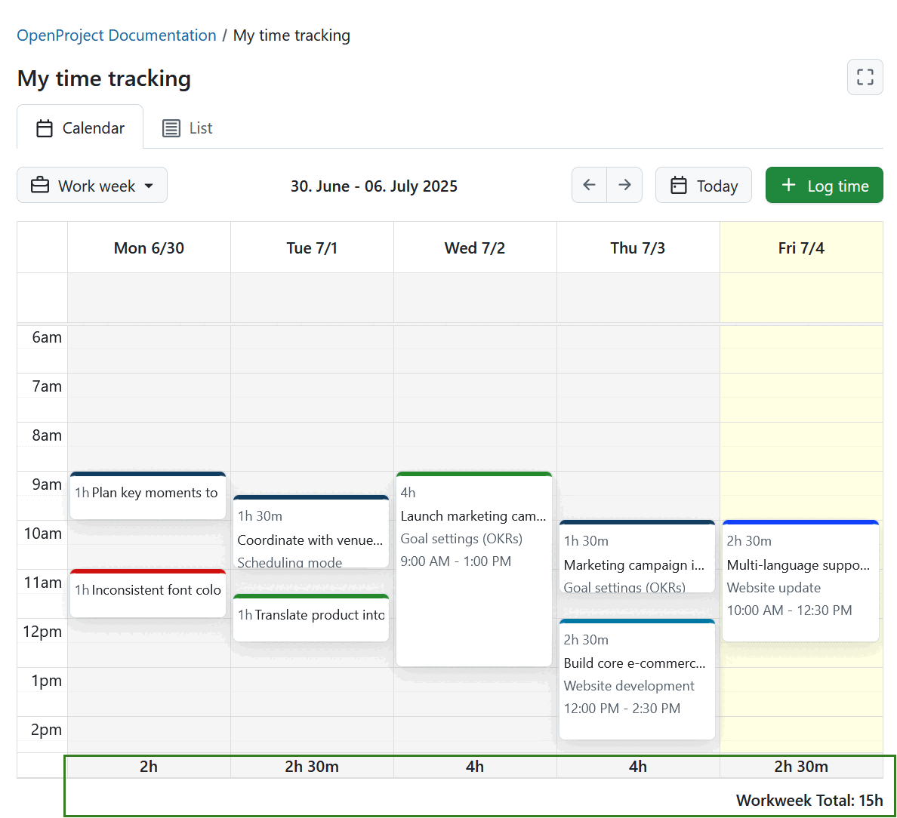

If you are currently tracking time with a timer for a specific work package, you will also see the ongoing time tracking timer for the respective work package. The work package in question also has a different background color for easier differentiation.

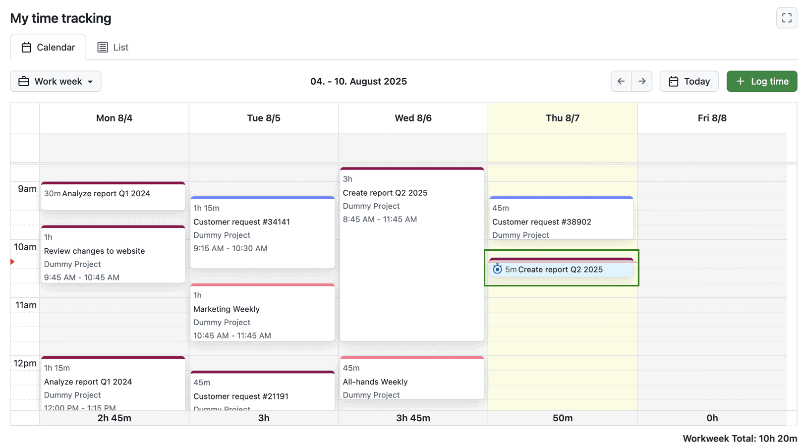

### List view

The _List_ view opens by default if start and finish times for time entries are **disabled** in [System Administration](../../../system-admin-guide/time-and-costs). Just like in the _Calendar_ view, you can select the zoom level using the dropdown menu — options include **Day**, **Work week**, **Week**, or **Month**.

In this view, time entries are grouped by day. Each day displays the total number of entries and their combined duration on the right side of the header line.

- When the **Day** zoom is selected, the view is expanded by default.

- When **Week** or **Work week** zoom is selected, past and future days are collapsed by default. However, the current day is expanded.

- When **Month** zoom is selected, past days or weeks are collapsed by default. However, the current week is expanded, along with all future weeks of that month.

> [!TIP]
> If monthly level is chosen in the list view mode, time entries are aggregated by week and not by day. This is especially useful to get an overview of your tracked hours for each week.

Expanded days display time entries in a table format with the following columns:

- **Time**
- **Hours**
- **Subject** (with a clickable link to the work package)
- **Project**
- **Activity**
- **Comment**
- **+** (last column, used to log time for that specific day)

To log time in _List_ view, you can either:

- Click the **+ Log Time** button to add a time entry for any date outside the currently displayed range.
- Use the **+** icon in the table to log time directly for a specific day.

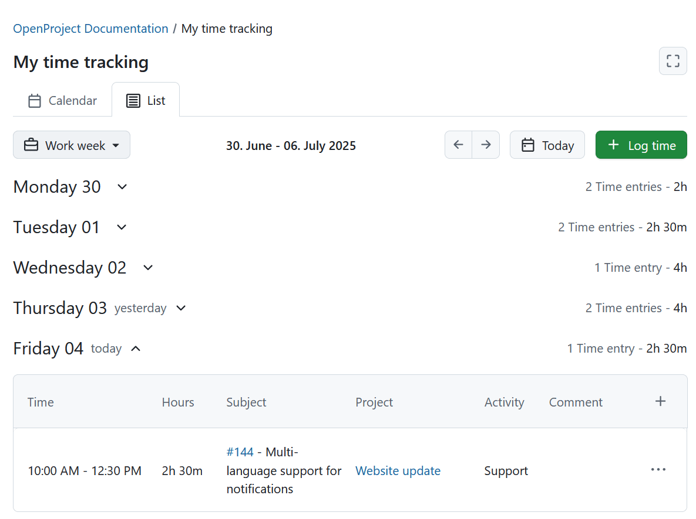

To edit or delete a time entry in the _List_ view, click the **More** (three dots) icon at the end of the entry’s row in the table, then select the **Edit** (pencil) or **Delete** icon respectively.

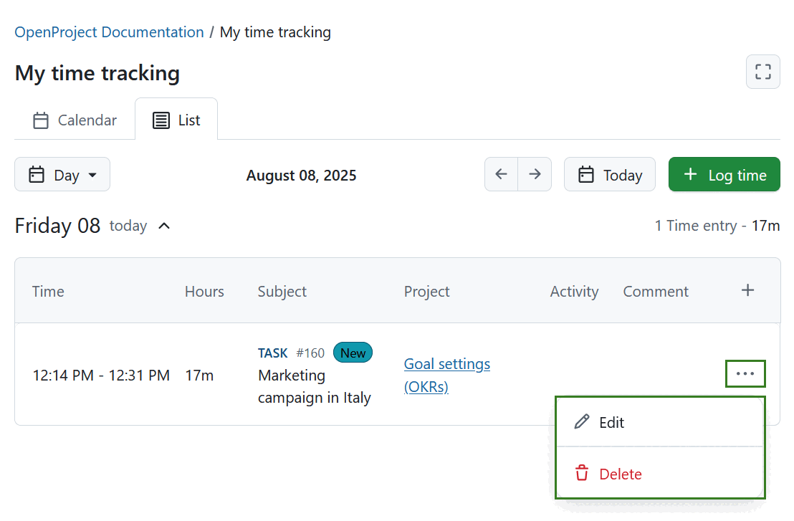

### Stack view

The _Stack_ view shows how many hours you have logged and how many are still planned for each day. Entries are stacked on top of each other, so the height of a column shows the total hours of that day. The scale on the left shows hours, not the time of day. Non-working days are shaded.

You can select the zoom level **Day**, **Work week** or **Week**. The **Month** zoom level is not available in this view.

Time entries are displayed at the bottom of each day, followed by a running timer if there is one. [Resource allocations](#resource-allocations-in-my-work) are stacked on top.

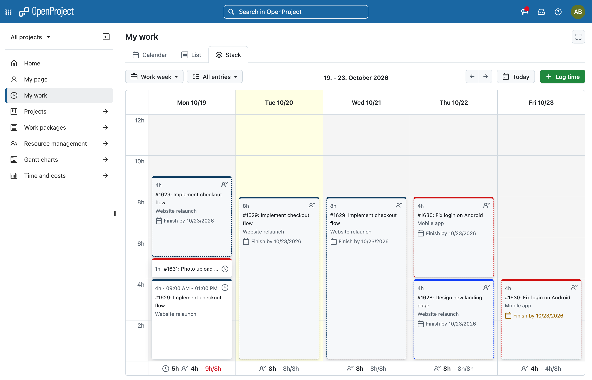

To log time, select a range in a day. The **Hours** field is pre-filled with the length of the selected range. You can also use the **+ Log time** button.

Click a time entry to edit or delete it.

At the bottom of each day you see:

- the hours you have logged
- the allocated hours you are expected to work
- the sum of both compared to your working hours of that day, for example *9h/8h*

The sum is shown in red if logged and allocated hours together exceed your working hours.

## Resource allocations in My work

If work is allocated to you in [Resource management](../../resource-management/), your allocations are displayed in all views of the _My work_ page.

OpenProject distributes the hours of an allocation over your working days within the allocated dates. Time you have already logged on the same work package on that day is subtracted, so you only see the hours that are still left.

Allocations have a dashed border. Each allocation shows:

- the remaining expected hours for that day
- the work package and its project
- the finish date of the allocation, for example *Finish by 10/23/2026*. On the last day of the allocation this is highlighted.

In the _Calendar_ view, allocations are displayed in the area at the top of each day.

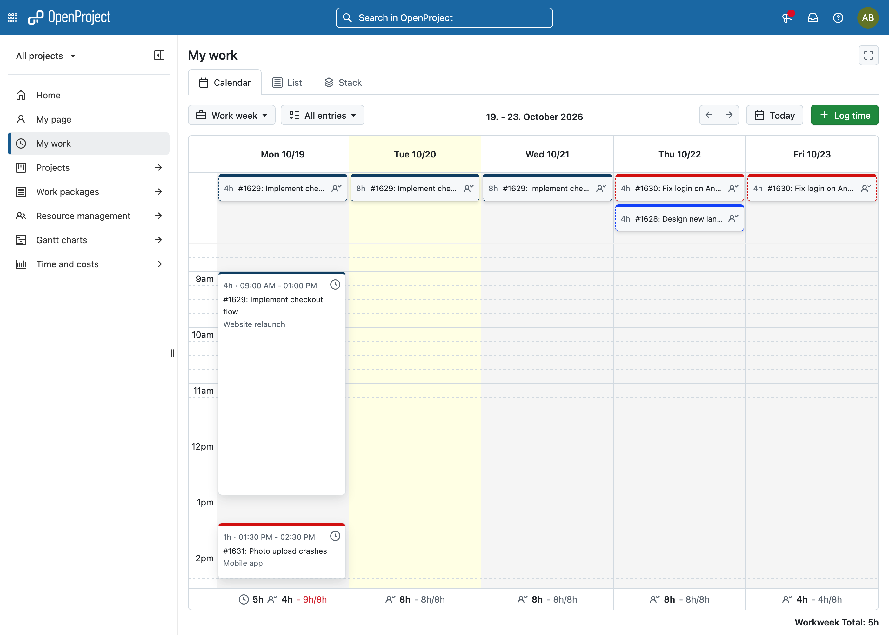

In the _List_ view, allocations are listed together with your time entries. The **Type** column shows **Resource Allocation** for them.

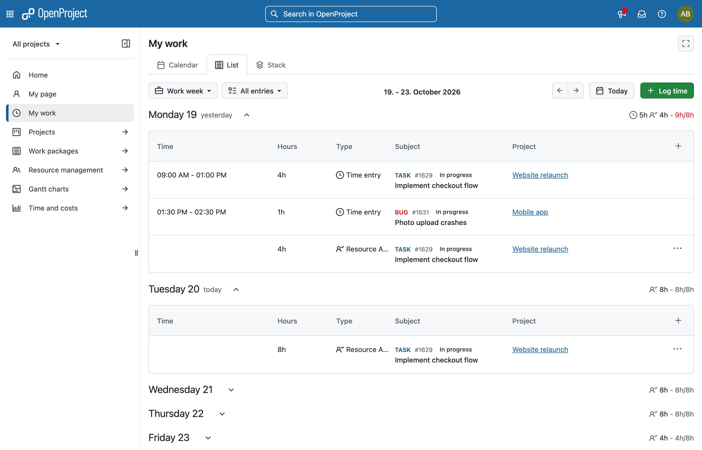

Click an allocation to see the available actions:

- **Open work package**
- **Open project**
- **Assign work package to me** – only shown if you are not the assignee of the work package.
- **Log time from allocation** – opens the log time dialog with the work package, date and remaining hours already filled in.

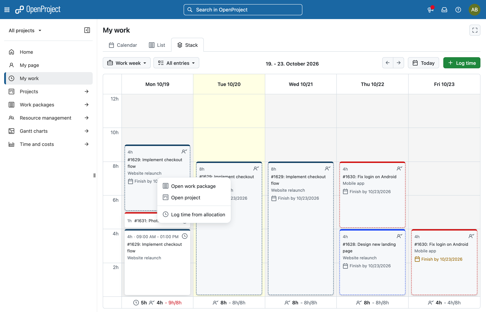

> [!NOTE]
> The _My spent time_ widget on [My page](../../../getting-started/my-page/) also uses the stack view, but only shows your logged time.

## Log time in My work module

To log time on the _My work_ page, click the **+ Log time** button. A modal window will appear with the following fields:

- **Date** – Select the day for the time entry.

- **Start time** and **Finish time** – When both are entered, the **Hours** field is calculated automatically.

> [!TIP]
> These fields are only visible if the **Allow exact times tracking** option is enabled by an administrator.
> If the **Require exact times** option is also enabled, these fields become mandatory in order to save the time entry.

- **Hours** – Enter the number of hours you want to log for a specific work package.

> [!TIP]
> Duration can be entered both in hours and minutes. For example for logging 1,5 hours, you can enter:
>
> - 1.5h
> - 90m
> - 90min
> - 1:30

- **Work package** – Type to search for a work package or select from the list of recently used ones. You can find the correct work package by using a work package name, ID, type and status.

- **Activity** – Choose an activity that is active for the project the selected work package belongs to.

- **Comment** – Add any relevant notes or details for the time entry.

Don't forget to click the **Log** button to save your time entry.

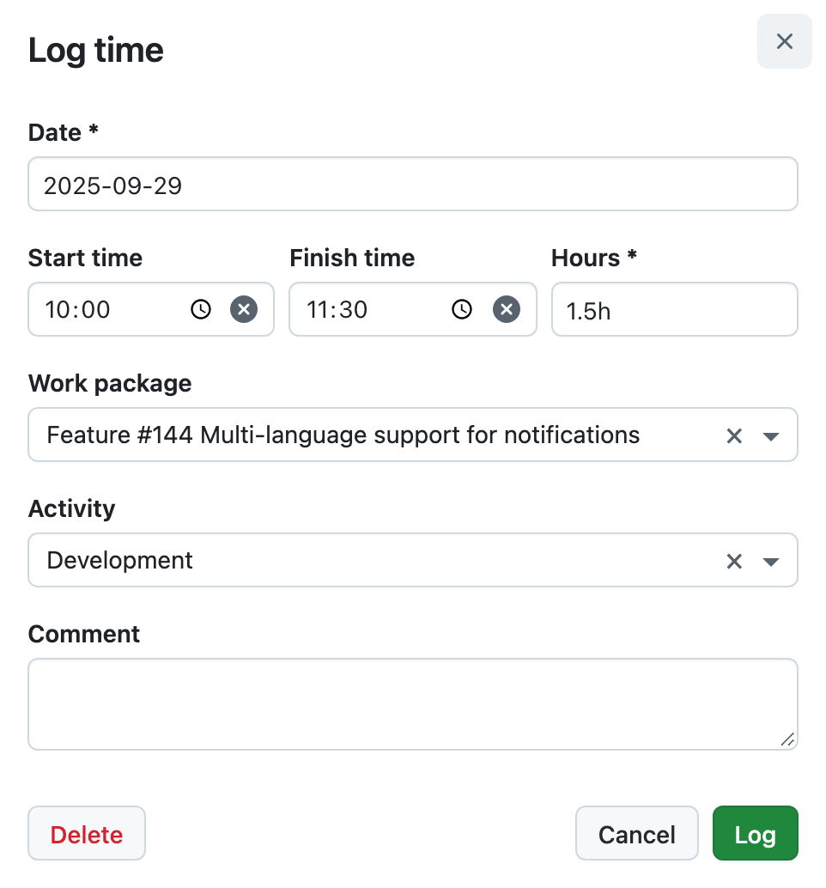
