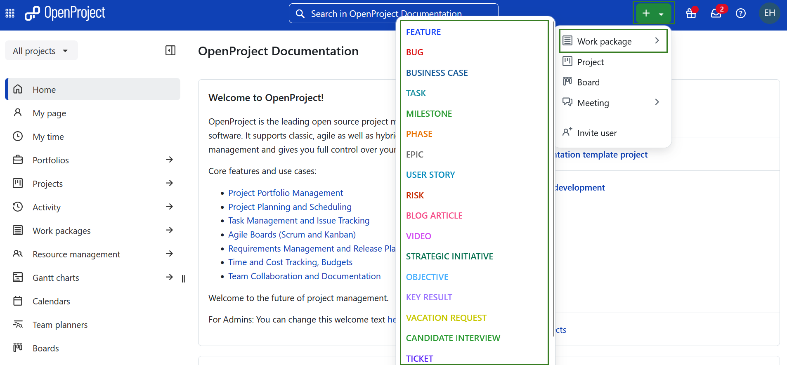
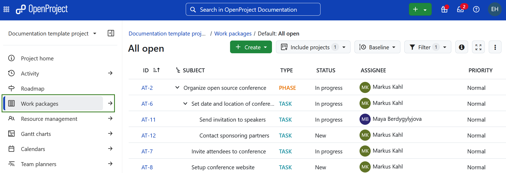
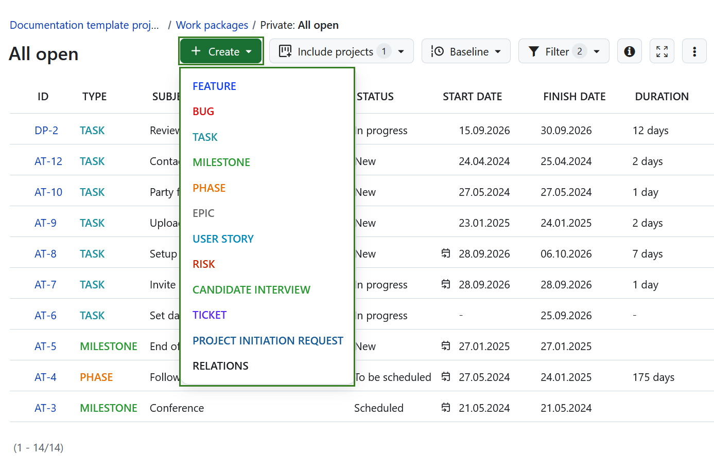
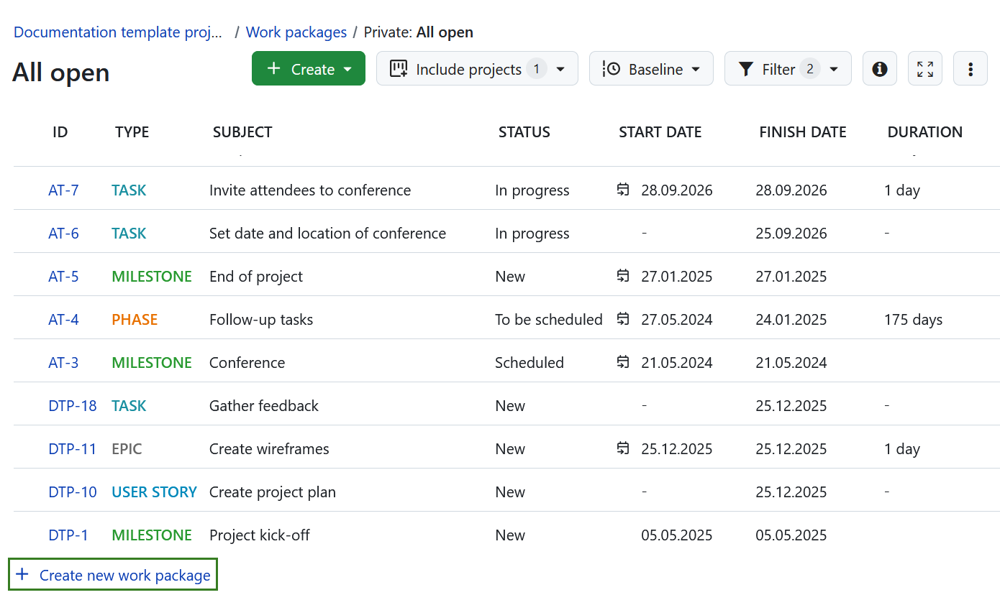
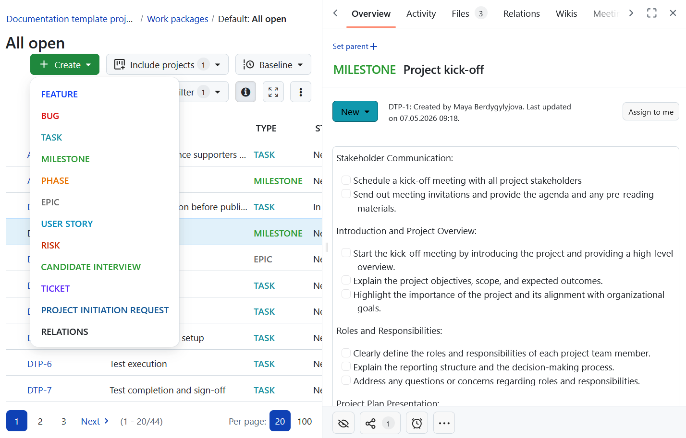
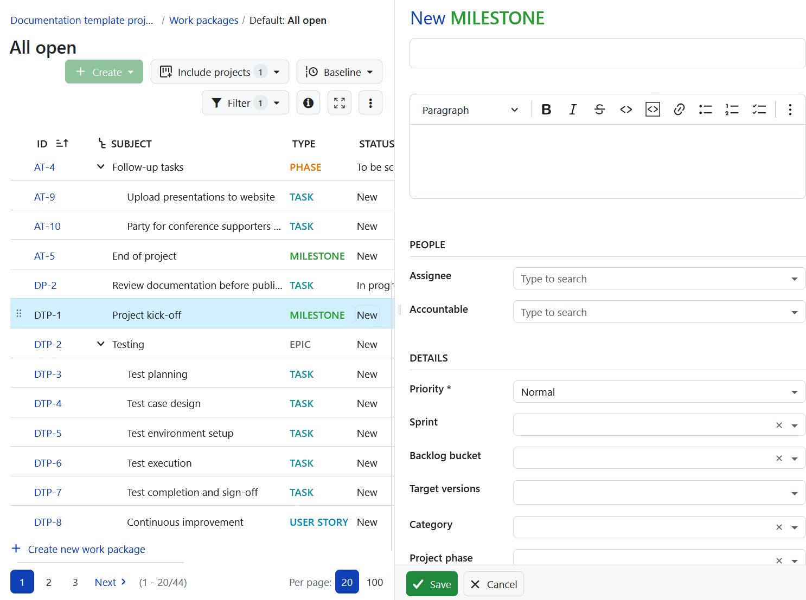
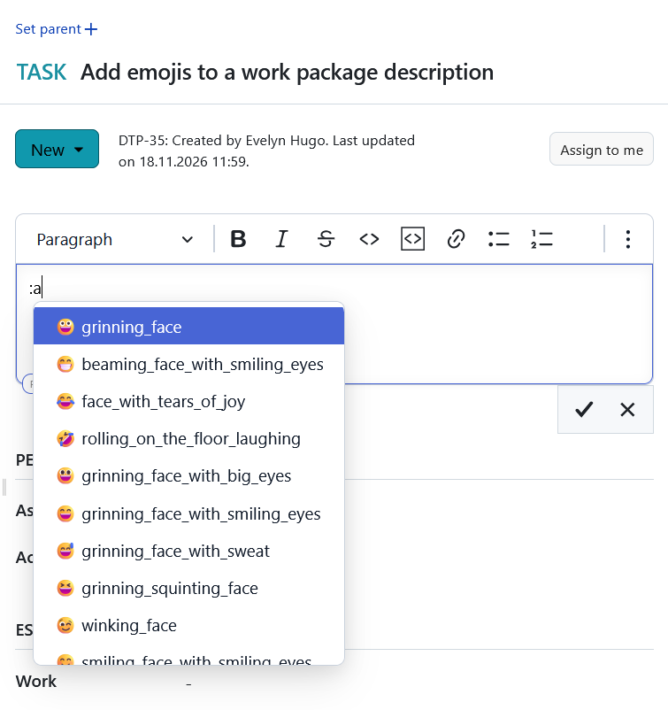

---
sidebar_navigation:
  title: Create work packages
  priority: 990
description: How to create work packages in OpenProject.
keywords: create work package, new work package, add work package
---

# Create work packages

| Topic                                                                  | Content                                        |
|------------------------------------------------------------------------|------------------------------------------------|
| [Create work packages](#create-work-packages)                          | How to create a new work package in a project. |
| [Add emojis to work packages](#add-emojis-to-work-packages)            | How to add emojis to a work package description. |
| [Add attachments to work packages](#add-attachments-to-work-packages)  | How to add attachments to a work package.      |

## Create work packages

There are several ways to create work packages in OpenProject:

- [Through the header navigation](#create-a-work-package-via-header-navigation) from anywhere within the application
- [In the work packages module](#create-a-work-package-in-the-work-packages-module) of a project or across all projects
- [Inline in the work package table](#create-a-work-package-in-the-table-view) to quickly create multiple work packages
- [In a split screen view](#create-a-work-package-in-the-split-screen-view) which allows you to specify detailed information from the start

You can also create work packages from other places in OpenProject, for example [from a document](../../documents/#create-a-new-work-package-from-within-a-document), or create many work packages at once by [importing them from a CSV file](../importing/).

### Create a work package via header navigation

You can create a work package from anywhere within the application by clicking the green **+** button in the header navigation and directly selecting a work package type.

A form will open, where you can specify the project, name, description, priority, dates, etc. Depending on the selected work package type and project, the form may include additional fields to fill out. Required fields are marked with an asterisk (*).

> [!TIP]
>
> If you have not yet selected the project, _Assignee_ and _Accountable_ will show no selectable values. Once you select a project, members of the selected project will be selectable.

### Create a work package in the work packages module

You can also create a work package directly from within the work packages module, either within a specific project or from the global module level.

[Select a project](../../../getting-started/projects/#open-an-existing-project) and navigate to the **Work packages** module in the project menu on the left. Alternatively, select the global **Work packages** module.

Click the **+ Create** button above the work packages table and select the type of work package you want to create.

### Create a work package in the table view

To create new work packages directly inline in the table view, click the **+ Create new work package** link below the table.

The new work package appears in a highlighted row in the table. Type in the subject of the work package, change attributes such as type or status directly in the table, and press **Enter** to save the changes.

This way, you can quickly and easily create new work packages in the table.

### Create a work package in the split screen view

To enter detailed information into the work package from the start, you can create a work package in the split screen view. In the work packages module, click the green **+ Create** button and select the type of work package you want to create.

The new work package form will open in the split screen view. Enter all information, such as description, assignee, status, priority, due date and more.

Click the **Save** button.

To find out how to create a child work package, see [Add a child work package](../work-package-relations-hierarchies/#add-a-child-work-package).

## Add emojis to work packages

You can add emojis to all text editors, including the work package description. Type a colon and a letter, e.g. **:a** into the text editor and get a suggested list of emojis you can use.

## Add attachments to work packages

You can directly add images, e.g. via copy and paste, to the **work package description**. You can also use the toolbar above the work package description and click the **Insert image** icon:

At the bottom of the work package form, you can add files via drag and drop or select a file from a folder to upload it to the work package.

> [!TIP]
> It is also possible for users that are not members of the project to add attachments to work packages if they have been granted permission by an administrator. This can be useful, for example, for confirming bug reports.

Find out how to [edit existing work packages](../edit-work-package).

> [!NOTE]
> You can also use [Nextcloud](../../file-management/nextcloud-integration/#link-files-and-folders-to-work-packages), [OneDrive](../../file-management/one-drive-integration/#link-files-and-folders-to-work-packages) or [SharePoint](../../file-management/sharepoint-integration/) integrations to upload files to a file storage or link already existing files or folders to a work package under the tab **Files**.
