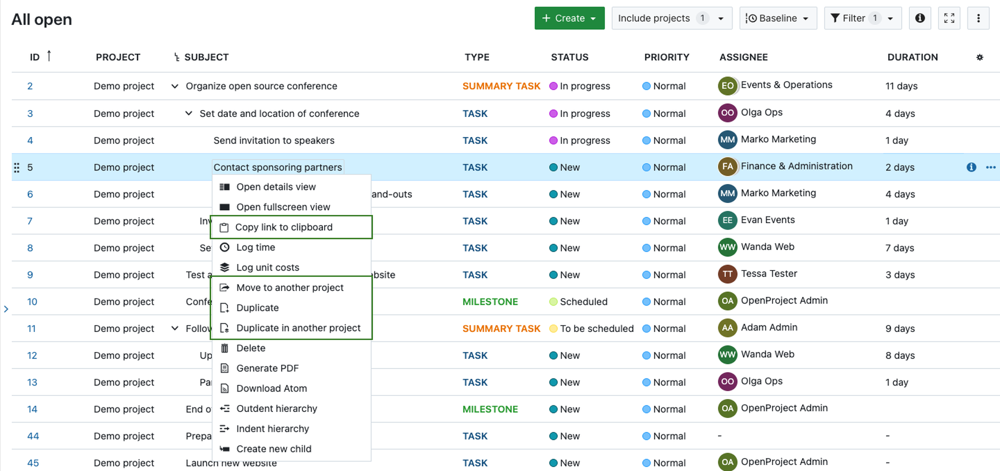
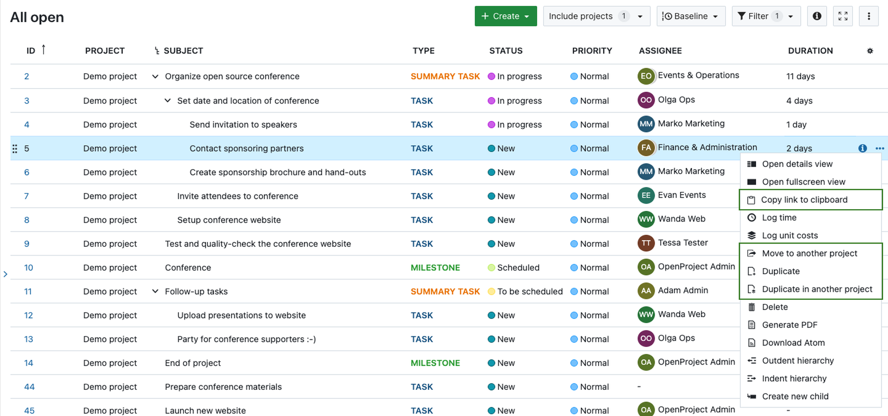
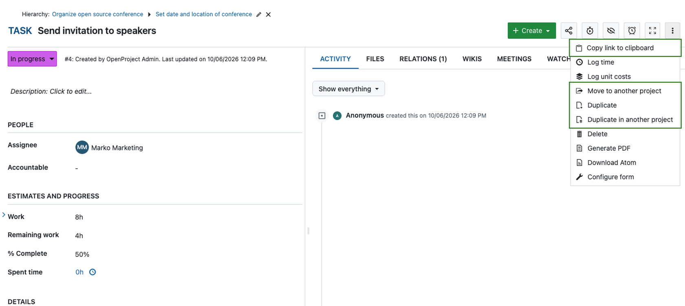
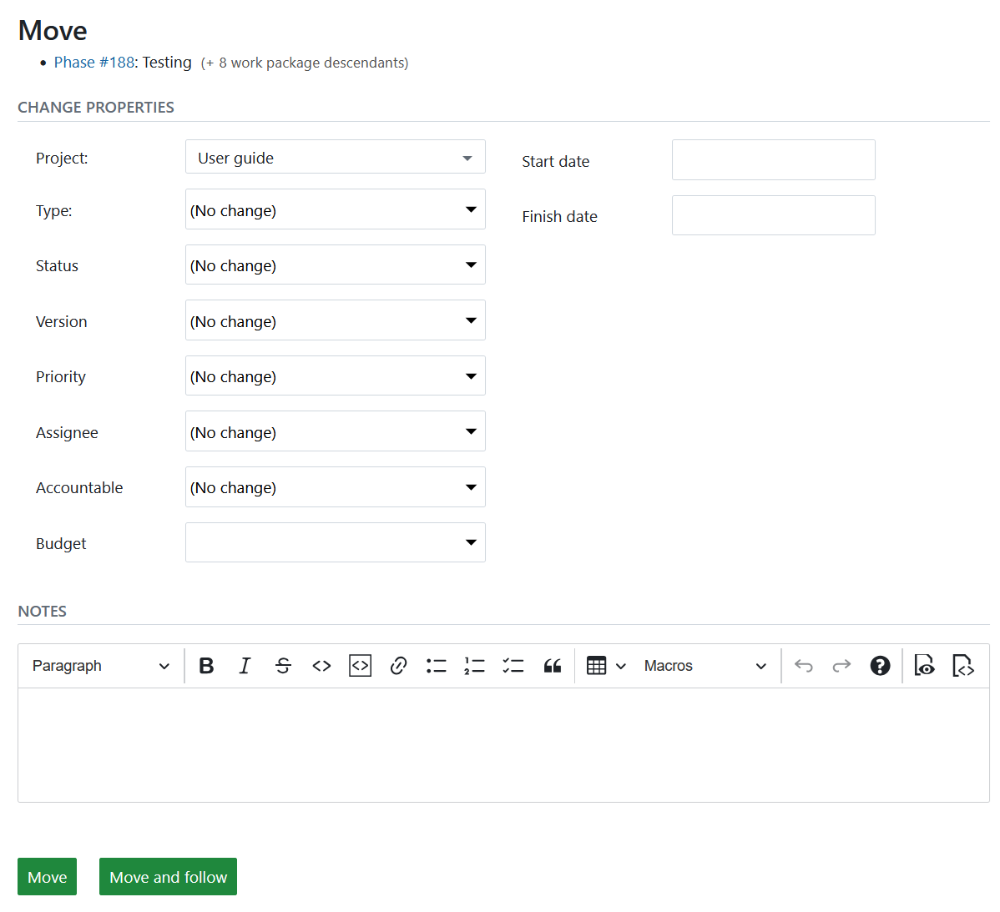
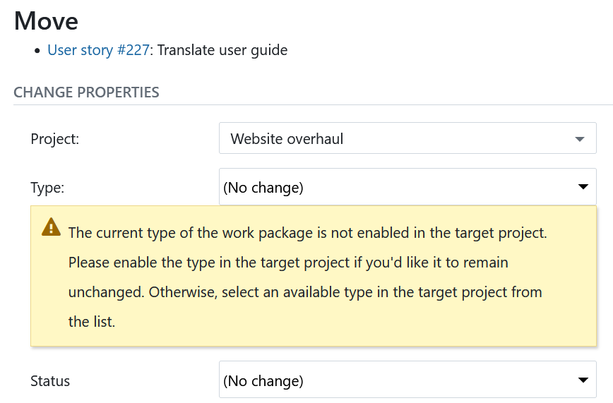
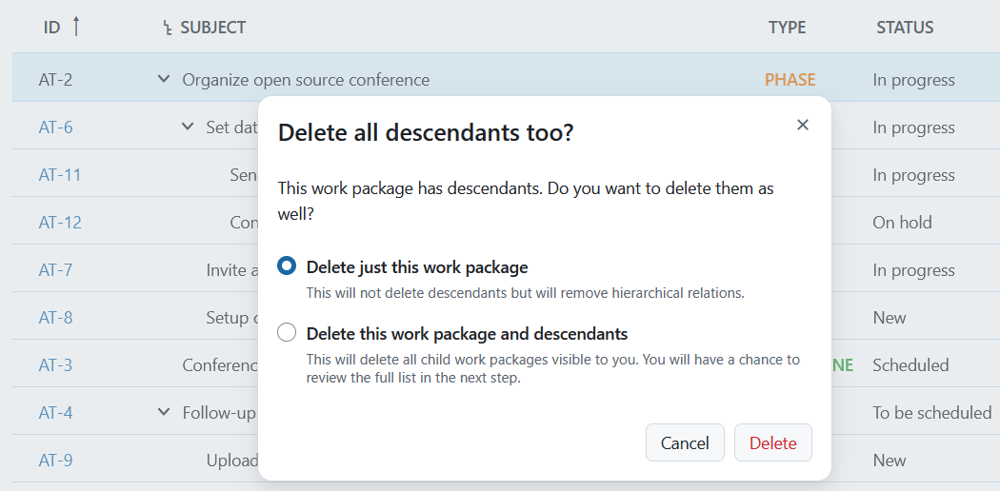
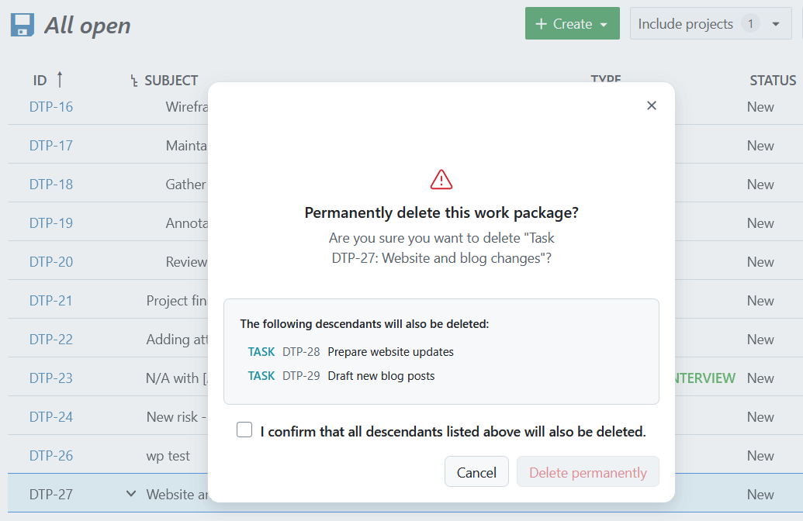

---
sidebar_navigation:
  title: Duplicate, move, delete work packages
  priority: 960
description: How to duplicate, move to another project or delete a work package.
keywords: copy work package, duplicate work package, delete work package, move work package, copy work package ID, copy link
---

# Duplicate, move to another project or delete a work package

If you right-click in a work package table, or press **Shift** + **F10** on a work package with the keyboard, editing options will be displayed. Here, you can duplicate a work package, duplicate it in another project, move it to another project, copy its link or ID to the clipboard, or delete it.

You can also access these features by using the three dots at the far right of a row to access the menu.

Alternatively, open the work packages details view by double clicking the respective row, click on **More functions** (the three dots at the top right of the work package details) and select the respective menu item.

To duplicate, move or delete multiple work packages at once please refer to the documentation for [bulk edit](../edit-work-package/#bulk-edit-work-packages).

## Duplicate a work package

When you select **Duplicate**, a work package form with the pre-set values of the original work package is shown. This allows you to easily create and adjust new work packages based on existing ones.

To create the copy in a different project, select **Duplicate in another project** instead.

## Copy link to clipboard

**Copy link to clipboard** copies a short link to the work package to your clipboard so you can quickly paste it elsewhere. It can also be useful when you want to quickly copy links to multiple work packages without having to open the detailed view of each one.

## Copy work package ID

**Copy work package ID** copies the ID of the work package to your clipboard, for example `#2421` or `#PROJ-42`, depending on the identifiers used in your installation. This is useful when you want to refer to a work package elsewhere, for example in a comment, a document, or a commit message.

The option is available in the **More** (three dots) menu of a work package, for example in the work package table, the Gantt chart, the work package details, and on boards.

## Move a work package to a different project

The _Move to another project_ option moves a work package to another project or subproject. Select the project into which the work package is to be moved, check whether further adjustments are necessary and confirm by clicking on _Move_.

> [!NOTE]
> You can only move a work package into projects that you are a member of and for which you are authorized to carry out this function.

> [!TIP]
> If the current work package type does not exist in the target project, you will see a warning message asking you to either activate a desired work package type or select one of the activated ones. Read more on [activating a work package type for a specific project](../../projects/project-settings/work-packages/#work-package-types) or [creating new work package types in OpenProject administration](../../../system-admin-guide/manage-work-packages/work-package-types/).

> [!TIP]
> If the work package you are moving has children work packages, they will be moved as well.

## Delete a work package

The right to delete work packages is tied to specified roles (for example system administrators). The roles and permission may vary from project to project. 

You can select these options either in the detail view under _More_ or via the context menu by right-clicking into the work package table. The latter option allows you to perform an action (such as copying, moving or deleting a work package) on multiple work packages at once.

If a work package has descendants, a confirmation dialog asks whether you want to delete only the parent work package or the parent and all its descendants.

If you select *Delete this work package and descendants,* a warning dialog appears. Review the action, select the confirmation checkbox, and click **Delete permanently**.

