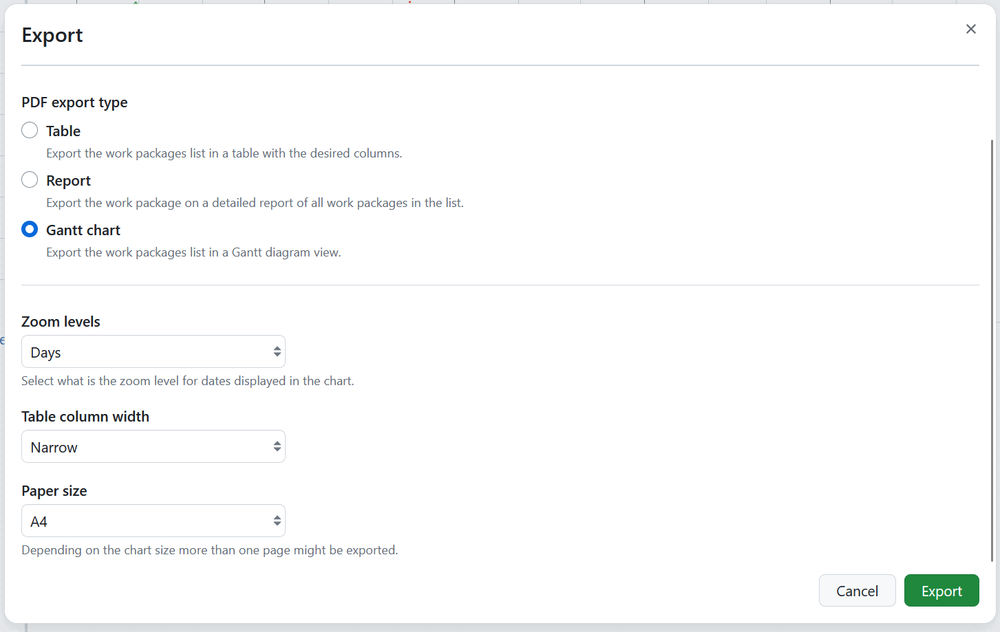

---
sidebar_navigation:
  title: Gantt chart PDF export
  priority: 700
description: How to export Gantt charts in PDF format in OpenProject
keywords: work package exports, Gantt chart PDF, Gantt export, PDF export
---

# Gantt chart PDF export

[feature: gantt_pdf_export ]

You can export Gantt charts directly from the work packages module by selecting the respective option, or from the Gantt charts module by doing the same.

When you open the export dialog from the Gantt charts module, the PDF Gantt export type is pre-selected, unless other export settings have been saved for the view.

## Columns

You can choose which work package attributes are shown as columns in the table next to the chart and change their order. Up to six columns can be selected, at least one is required. The pre-selected columns are _ID_, _Subject_, _Start date_ and _Finish date_, independent of the columns of the work package table. Long text fields and relation columns are not available.

The width of each column adapts to its content, so the chart gets as much space as possible. Text that does not fit is shown on up to two lines and then shortened with an ellipsis.

If the work package table is grouped by an attribute, each group starts with a row showing the group value.

To share the column selection with other users of the view, [save the export settings](../#save-export-settings).

## Export options

- **Include work packages without dates** adds work packages without a start and finish date to the export. They are listed in the table with empty chart cells. By default, they are left out.
- **Zoom levels** define the zoom level for the dates displayed in the chart. You can select _Days_ (default), _Weeks_, _Months_ or _Quarters_.
- **Date column width** defines the width of each day, week, month or quarter in the chart. You can select _Narrow_, _Medium_ (default), _Wide_ or _Very wide_.
- **Paper size** defines the page size of the export. You can select _A4_ (default), _A3_, _A2_, _A1_, _A0_, _Executive_, _Folio_, _Letter_ or _Tabloid_. Depending on the chart size, more than one page might be exported.

For more information on using the Gantt chart module and Gantt exports, please refer to the [Gantt chart PDF Export guide](../../../gantt-chart/#gantt-chart-pdf-export-enterprise-add-on).

See [Export work packages](../) for how to trigger an export and adjust the general export options.